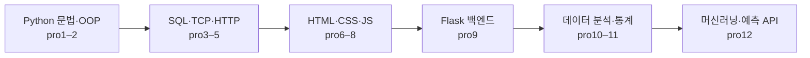
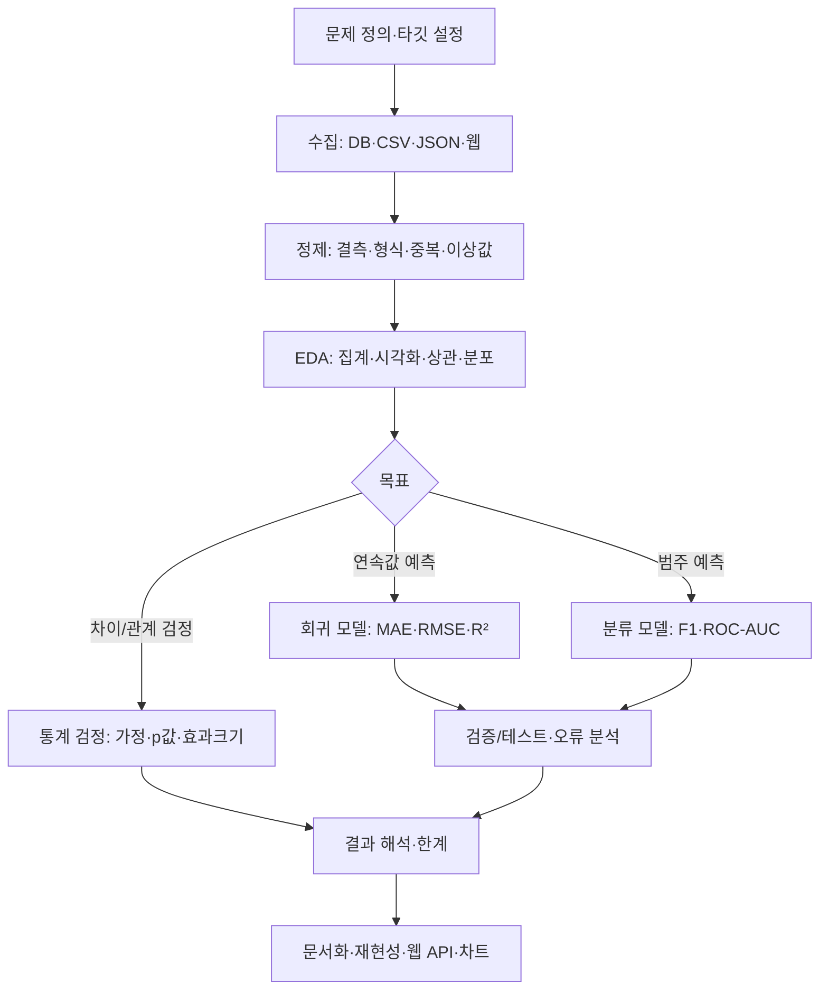

# Python · Web · Database · Statistics · Machine Learning | 학습 포트폴리오

> Python 기초부터 객체지향, SQL·DB, 웹 프런트엔드, Flask 백엔드, 데이터 처리·시각화, 통계적 가설검정, 머신러닝까지 **단계별 학습 내용을 실제 실습 코드와 연결**해 기록한 저장소입니다.

**문서 기준:** 제공받은 `projects.zip`의 `pro1`~`pro11` 코드와, 별도로 제공받은 최신 `pro12ml.zip`을 분석해 정리했습니다. **전체 12개 폴더, 주요 코드 파일 302개**(`pro1~pro11` 243개 + `pro12ml` 59개: Python/HTML/JS/CSS 기준)입니다. 숫자는 코드 파일에 한정하며 이미지·CSV·JSON·모델 산출물은 별도입니다. 대부분 교육용 독립 실습이므로 모든 파일이 하나의 앱처럼 함께 실행되지는 않습니다.

이 README는 저장소 최상위 `works/README.md` 위치를 가정합니다. 폴더가 `projects/` 내부에 놓였을 때 상대 링크가 작동하며, README 내용과 별도로 실제 코드 파일을 GitHub에 업로드해야 링크를 열 수 있습니다. `pro12ml`은 **최신 별도 압축파일** 기준으로 설명합니다.

## 전체 학습 흐름



## 프로젝트 바로가기

| 순서 | 프로젝트 | 공부한 내용 | 주요 코드 수 | 상세 학습 문서 |
|---:|---|---|---:|---|
| 01 | [`pro1`](projects/pro1/) | Python 문법과 객체지향 — 자료형·함수·데코레이터·모듈·상속·추상화 | 49 | [`READMEpro01.md`](projects/pro1/READMEpro01.md) |
| 02 | [`pro2`](projects/pro2/) | 예외 처리와 파일 입출력 — 오류 처리·텍스트 파일·with·데이터 집계 | 6 | [`READMEpro02.md`](projects/pro2/READMEpro02.md) |
| 03 | [`pro3db`](projects/pro3db/) | 관계형 DB와 TCP 소켓 — SQLite·MariaDB·JOIN·트랜잭션·socket | 10 | [`READMEpro03.md`](projects/pro3db/READMEpro03.md) |
| 04 | [`pro4web`](projects/pro4web/) | HTTP 서버의 기초 — 요청/응답·정적 HTML 제공 | 3 | [`READMEpro04.md`](projects/pro4web/READMEpro04.md) |
| 05 | [`pro5web2`](projects/pro5web2/) | CGI로 이해하는 동적 웹 — GET/POST·폼 전송·HTML 응답·DB 조회 | 8 | [`READMEpro05.md`](projects/pro5web2/READMEpro05.md) |
| 06 | [`pro6web3basic`](projects/pro6web3basic/) | HTML/CSS 웹 문서 — 태그·표·폼·선택자·박스 모델 | 7 | [`READMEpro06.md`](projects/pro6web3basic/READMEpro06.md) |
| 07 | [`pro7quiz`](projects/pro7quiz/) | 다중 페이지 웹사이트 — 메뉴·페이지 분할·iframe·레이아웃 | 5 | [`READMEpro07.md`](projects/pro7quiz/READMEpro07.md) |
| 08 | [`pro8js`](projects/pro8js/) | JavaScript와 비동기 통신 — DOM·이벤트·JSON·XHR·fetch·Axios | 24 | [`READMEpro08.md`](projects/pro8js/READMEpro08.md) |
| 09 | [`pro9flask`](projects/pro9flask/) | Flask 웹 백엔드·REST — Jinja2·쿠키/세션·CRUD·API·DB·차트 | 72 | [`READMEpro09.md`](projects/pro9flask/READMEpro09.md) |
| 10 | [`pro10anal1`](projects/pro10anal1/) | Python 데이터 분석 — NumPy·Pandas·시각화·크롤링·NLP | 32 | [`READMEpro10.md`](projects/pro10anal1/READMEpro10.md) |
| 11 | [`pro11anal2`](projects/pro11anal2/) | 통계적 추론과 가설검정 — 카이제곱·t-검정·ANOVA·설문 분석 | 27 | [`READMEpro11.md`](projects/pro11anal2/READMEpro11.md) |
| 12 | [`pro12ml`](projects/pro12ml/) | 머신러닝과 예측 서비스 — 회귀·분류·앙상블·PCA·MLP·Flask 예측 | 59 | [`READMEpro12.md`](projects/pro12ml/READMEpro12.md) |

> **읽는 순서:** 먼저 각 프로젝트의 '필수 이론'을 읽고, 아래 **파일별 설명표**에서 파일 역할을 확인한 뒤 직접 코드를 실행합니다. `READMEpro01.md`~`READMEpro12.md`는 세부 설명으로 연결됩니다. 링크는 해당 파일이 저장소에 실제 업로드되어 있을 때 열립니다.

## 저장소 구조 (권장)

```text
works/
├── README.md                       # 이 종합 안내서 (저장소 첫 화면)
└── projects/
    ├── pro1/ ... READMEpro01.md
    ├── pro2/ ... READMEpro02.md
    ├── pro3db/ ... READMEpro03.md
    ├── pro4web/ ... READMEpro04.md
    ├── pro5web2/ ... READMEpro05.md
    ├── pro6web3basic/ ... READMEpro06.md
    ├── pro7quiz/ ... READMEpro07.md
    ├── pro8js/ ... READMEpro08.md
    ├── pro9flask/ ... READMEpro09.md
    ├── pro10anal1/ ... READMEpro10.md
    ├── pro11anal2/ ... READMEpro11.md
    ├── pro12ml/ ... READMEpro12.md
    └── pro13/                          # 추후 추가 시 실제 폴더명에 맞게 반영
```

> `pro13`은 **예정 항목**이며 아직 제공된 코드 분석에는 포함되지 않습니다. `READMEproXX.md`라는 파일명은 GitHub가 각 폴더에서 자동 표시하는 `README.md`와 다르므로, 종합 README에서 링크로 안내합니다.

## 공통 핵심 개념: 프로젝트 간 연결

| 질문 | 학습을 통해 연결되는 답 | 해당 프로젝트 |
|---|---|---|
| 반복되는 처리를 어떻게 정리할까? | 함수·모듈·클래스·추상 인터페이스로 재사용 | `pro1`, `pro2` |
| DB 조회와 파일 처리는 어떻게 다른가? | 구조화된 SQL 테이블 vs 파일 스트림·경로·인코딩 | `pro2`, `pro3db`, `pro10anal1` |
| 웹브라우저에서 Python을 직접 실행할 수 있을까? | 보통 서버의 Python(Flask)이 요청을 받고 HTML/JSON을 돌려준다 | `pro4`, `pro5`, `pro8`, `pro9` |
| 데이터는 어떻게 화면에 표시될까? | HTML/CSS 구조 + JS 이벤트/비동기 요청 + Flask API | `pro6`~`pro9` |
| 데이터 집계는 언제 SQL, 언제 Pandas를 쓸까? | DB에서 필요한 행만 조회/집계한 뒤 분석·시각화로 확장 | `pro3db`, `pro9flask`, `pro10anal1` |
| 두 그룹의 차이는 유의한가? | 표본 설계 → 가정 확인 → 적절한 검정 → 효과·불확실성 해석 | `pro11anal2` |
| 새 데이터의 값을 예측할 수 있을까? | 전처리 → 분리 → 모델 학습 → 적절한 지표 평가 → 예측 | `pro12ml` |
| 분석 결과를 다른 사람이 사용하게 하려면? | DB/CSV → DataFrame → 통계/ML → Flask JSON API → 브라우저 | `pro9flask`, `pro10anal1`, `pro11anal2`, `pro12ml` |

---

## pro1

**Python 문법과 객체지향** · 프로젝트 01 · 주요 코드 49개 · [폴더 열기](projects/pro1/) · [개별 이론 README](projects/pro1/READMEpro01.md)

**학습 목표:** Python 문법을 단순히 실행하는 수준에서 나아가, 함수로 기능을 분리하고 객체지향 구조로 상태와 동작을 모델링한다.

### 반드시 알아야 할 이론

1. **변수·자료형·자료구조** — `int`, `float`, `str`, `bool`과 `list`·`tuple`·`set`·`dict`의 차이를 이해한다. 리스트는 가변, 튜플은 불변이다. `==`는 값의 동등성을, `is`는 객체 동일성을 비교한다. 얕은 복사와 깊은 복사는 중첩 리스트를 수정할 때 차이가 커진다.
2. **분기·반복** — `if/elif/else`, `for`, `while`, `break`, `continue`로 데이터와 업무 규칙을 처리한다. `range`, `enumerate`, `zip`, 컴프리헨션은 반복 로직을 간결하게 만드는 핵심 도구다.
3. **함수와 스코프** — 함수 인수는 위치·키워드·기본값·`*args`·`**kwargs`로 전달할 수 있다. `return`은 값을 반환하고, `print`는 출력만 한다. 지역변수·전역변수·`nonlocal`의 범위를 구분한다.
4. **클로저와 데코레이터** — 내부 함수가 바깥 함수의 변수를 기억하는 구조가 클로저다. `@decorator`는 공통 로깅·검증 등을 여러 함수에 재사용할 때 쓰인다. 데코레이터는 보통 `functools.wraps`를 이용해 원본 함수 메타데이터를 보존한다.
5. **모듈·패키지** — 모듈은 `.py` 파일 단위, 패키지는 관련 모듈을 묶는 구조다. `import`, `from ... import`, `__init__.py`의 의미를 확인한다. 실행하는 파일과 import되는 파일은 `__name__` 값으로 구분할 수 있다.
6. **OOP의 네 가지 핵심 축** — **캡슐화**는 데이터와 동작을 묶고, **추상화**는 필요한 인터페이스만 드러내며, **상속**은 공통 구조를 재사용하고, **다형성**은 동일 메서드 호출을 객체 유형에 따라 다르게 처리한다. 상속 대신 객체를 포함하는 **합성(composition)** 이 더 적합한 경우도 많다.
7. **추상 클래스** — `ABC`와 `@abstractmethod`로 구현해야 할 동작을 계약처럼 정의한다. `super()`는 부모 클래스 초기화·동작을 재사용할 때 쓴다.

```python
from abc import ABC, abstractmethod

class Employee(ABC):
    @abstractmethod
    def pay(self) -> int:
        pass

class FullTime(Employee):
    def __init__(self, monthly_salary):
        self.monthly_salary = monthly_salary

    def pay(self):
        return self.monthly_salary

workers = [FullTime(3_000_000)]
for worker in workers:
    print(worker.pay())  # 같은 인터페이스로 다른 구현 호출 가능
```

**코드 연결:** `test1~test18`은 문법·모듈·외부 라이브러리 기반, `test19~test34`는 클래스·상속·다형성, `practice3~6`은 자판기·전자제품·직원급여 같은 과제로 객체 모델링을 연습한다. **복습 질문:** '어떤 조건에서 상속보다 합성이 좋은가?', '함수 밖에서도 지역 변수를 기억하는 이유는?'을 설명할 수 있어야 한다.

### `pro1` 파일별 코드 해설 (49개)

| 소스 파일 | 코드가 하는 일 | 연계 개념 |
|---|---|---|
| [`pack1/__init__.py`](projects/pro1/pack1/__init__.py) | 파이썬 패키지 인식용 초기화 파일 | 모듈·패키지·import |
| [`pack1/mymod1.py`](projects/pro1/pack1/mymod1.py) | 패키지 내부의 사용자 정의 함수 및 모듈 가져오기 예제 | 모듈·패키지·import |
| [`pack1/subpack/sbs.py`](projects/pro1/pack1/subpack/sbs.py) | 하위 패키지 함수 작성 | 모듈·패키지·import |
| [`pack1_other/mymod2.py`](projects/pro1/pack1_other/mymod2.py) | 합·차 함수로 모듈 재사용 실습 | 모듈·패키지·import |
| [`pack1_other/mymod3.py`](projects/pro1/pack1_other/mymod3.py) | 곱셈 함수로 Python import 경로 실습 | 모듈·패키지·import |
| [`practice1.py`](projects/pro1/practice1.py) | 정수 누적합·구구단·자리수 등 조건문/반복문 응용문제 | 조건/반복 응용·함수 또는 객체 모델링 |
| [`practice2.py`](projects/pro1/practice2.py) | 직원 정보 입력, 급여·근속 처리 함수 문제 | 조건/반복 응용·함수 또는 객체 모델링 |
| [`practice2a.py`](projects/pro1/practice2a.py) | 직원 급여·수당·근속 관련 계산 과제의 확장 풀이 | 조건/반복 응용·함수 또는 객체 모델링 |
| [`practice3.py`](projects/pro1/practice3.py) | 자판기와 동전 투입을 클래스로 모델링 | 조건/반복 응용·함수 또는 객체 모델링 |
| [`practice3a.py`](projects/pro1/practice3a.py) | 커피 자판기 예제: 동전과 컵 수량, 거스름돈 연산 | 조건/반복 응용·함수 또는 객체 모델링 |
| [`practice4.py`](projects/pro1/practice4.py) | 전자제품/TV/라디오의 클래스 상속과 메소드 재정의 | 조건/반복 응용·함수 또는 객체 모델링 |
| [`practice5.py`](projects/pro1/practice5.py) | 동물 클래스로 다중 상속과 동작 재정의 연습 | 조건/반복 응용·함수 또는 객체 모델링 |
| [`practice6.py`](projects/pro1/practice6.py) | 정규직·임시직 급여 계산을 추상클래스와 다형성으로 구현 | 조건/반복 응용·함수 또는 객체 모델링 |
| [`test1.py`](projects/pro1/test1.py) | 출력, 변수, 자료형, 기본 파이썬 실행 규칙 | 변수·자료형·분기·반복 |
| [`test2.py`](projects/pro1/test2.py) | 산술·할당·비교 연산자와 연산자 우선순위 | 변수·자료형·분기·반복 |
| [`test3.py`](projects/pro1/test3.py) | 문자열·리스트·튜플·집합·딕셔너리 자료구조 | 변수·자료형·분기·반복 |
| [`test4.py`](projects/pro1/test4.py) | 정규표현식 패턴 매칭 기초 | 변수·자료형·분기·반복 |
| [`test5if.py`](projects/pro1/test5if.py) | if/elif/else 조건문과 분기 처리 | 변수·자료형·분기·반복 |
| [`test6while.py`](projects/pro1/test6while.py) | while 반복·break·continue·반복 종료 동작 | 변수·자료형·분기·반복 |
| [`test7for.py`](projects/pro1/test7for.py) | for 반복, 중첩 반복, 수치 합계·빈도 계산 | 변수·자료형·분기·반복 |
| [`test8f1.py`](projects/pro1/test8f1.py) | 함수의 개념과 내장 함수 실습 | 함수·스코프·클로저·재귀 |
| [`test9f2.py`](projects/pro1/test9f2.py) | 사용자 정의 함수, 인수·반환값·스코프 | 함수·스코프·클로저·재귀 |
| [`test10f3.py`](projects/pro1/test10f3.py) | 위치·기본값·키워드·가변 매개변수 | 함수·스코프·클로저·재귀 |
| [`test11closure.py`](projects/pro1/test11closure.py) | 지역·전역·nonlocal 변수, 중첩 함수와 클로저 | 함수·스코프·클로저·재귀 |
| [`test12deco.py`](projects/pro1/test12deco.py) | @데코레이터로 함수 동작 감싸기 | 함수·스코프·클로저·재귀 |
| [`test13recursive.py`](projects/pro1/test13recursive.py) | 재귀 호출, 누적합, 팩토리얼 | 함수·스코프·클로저·재귀 |
| [`test14module.py`](projects/pro1/test14module.py) | 표준 모듈(math/random 등)과 모듈 사용 | 모듈·패키지·import |
| [`test15module.py`](projects/pro1/test15module.py) | 사용자 정의 모듈·패키지 import | 모듈·패키지·import |
| [`test16graphic.py`](projects/pro1/test16graphic.py) | Python 그래픽 모듈 사용 | 클래스·상속·추상화·합성 |
| [`test17pygame.py`](projects/pro1/test17pygame.py) | Pygame 라이브러리 호출 실습 | 외부 라이브러리·영상/그래픽 |
| [`test18opencv.py`](projects/pro1/test18opencv.py) | OpenCV로 이미지 읽기·표시 기초 | 외부 라이브러리·영상/그래픽 |
| [`test19class.py`](projects/pro1/test19class.py) | 클래스/인스턴스, 생성자·소멸자, 멤버 메소드 | 클래스·상속·추상화·합성 |
| [`test20class.py`](projects/pro1/test20class.py) | Car 예제로 객체 상태·멤버 변수/메소드 | 클래스·상속·추상화·합성 |
| [`test21class.py`](projects/pro1/test21class.py) | 클래스 메소드와 변수의 범위 이해 | 클래스·상속·추상화·합성 |
| [`test22class.py`](projects/pro1/test22class.py) | Singer 객체 생성과 클래스 자원 공유 | 클래스·상속·추상화·합성 |
| [`test22singer.py`](projects/pro1/test22singer.py) | 다른 파일에서 import할 Singer·Etc 클래스 | 클래스·상속·추상화·합성 |
| [`test23class.py`](projects/pro1/test23class.py) | 점 좌표·거리·기울기 등 클래스 기반 수치 처리 | 클래스·상속·추상화·합성 |
| [`test24pc.py`](projects/pro1/test24pc.py) | 자동차와 핸들 객체의 포함(composition) 관계 | 클래스·상속·추상화·합성 |
| [`test24ph.py`](projects/pro1/test24ph.py) | 자동차 핸들 객체의 좌·우회전 메소드 | 클래스·상속·추상화·합성 |
| [`test25fridge.py`](projects/pro1/test25fridge.py) | 냉장고에 음식 객체를 저장·조회하는 포함 관계 | 클래스·상속·추상화·합성 |
| [`test26Lotto.py`](projects/pro1/test26Lotto.py) | 공(ball) 객체와 LottoMachine으로 로또 번호 추출 | 클래스·상속·추상화·합성 |
| [`test27inherit.py`](projects/pro1/test27inherit.py) | Animal/Dog로 기본 상속 이해 | 클래스·상속·추상화·합성 |
| [`test28person.py`](projects/pro1/test28person.py) | Person/Employee 상속과 super 활용 | 클래스·상속·추상화·합성 |
| [`test29over.py`](projects/pro1/test29over.py) | 부모·자식 메소드 오버라이딩 | 클래스·상속·추상화·합성 |
| [`test30poly.py`](projects/pro1/test30poly.py) | 카드·현금·포인트 결제 예제로 다형성 | 클래스·상속·추상화·합성 |
| [`test31multi.py`](projects/pro1/test31multi.py) | Tiger/Lion/Liger로 다중 상속·메소드 탐색 순서 | 클래스·상속·추상화·합성 |
| [`test32abstract.py`](projects/pro1/test32abstract.py) | ABC 및 @abstractmethod를 이용한 추상클래스 | 클래스·상속·추상화·합성 |
| [`test33abstract.py`](projects/pro1/test33abstract.py) | 정규직·임시직 유형의 추상 급여 인터페이스 | 클래스·상속·추상화·합성 |
| [`test34abstract_poly.py`](projects/pro1/test34abstract_poly.py) | 일반·퀵배송·픽업 방식별 배송비 계산 다형성 | 클래스·상속·추상화·합성 |

**실행/학습 팁:** 자료형·반복문 → 함수 → 모듈 → 객체지향 순서로 실행하면 개념의 누적 관계가 분명해진다.

---

## pro2

**예외 처리와 파일 입출력** · 프로젝트 02 · 주요 코드 6개 · [폴더 열기](projects/pro2/) · [개별 이론 README](projects/pro2/READMEpro02.md)

**학습 목표:** 예상하지 못한 오류를 안전하게 처리하고, 디스크의 자료를 읽어 실용적인 데이터 처리 작업으로 연결한다.

### 반드시 알아야 할 이론

1. **예외 처리 흐름** — `try`에서 문제가 발생하면 적절한 `except`가 처리한다. 오류가 없을 때만 `else`를 실행할 수 있고, `finally`는 성공·실패와 무관하게 정리 작업에 쓴다. 너무 포괄적인 `except Exception: pass`는 오류 원인을 숨긴다.
2. **예외 유형** — `ValueError`(형식·값), `TypeError`(자료형), `FileNotFoundError`(경로), `ZeroDivisionError` 등 상황별 예외를 이해하고 필요한 부분만 잡는다.
3. **텍스트 파일** — `open(path, mode='r'/'w'/'a', encoding='utf-8')`; `with`는 블록을 벗어나면 파일을 닫는다. `w`는 기존 내용을 덮어쓰고 `a`는 덧붙인다. `read`, `readline`, 반복 순회는 메모리·용도에 맞게 선택한다.
4. **데이터 품질** — 파일에서 숫자를 읽을 때 공백 제거·타입 변환·빈 행·중복·잘못된 구분자 여부를 점검해야 한다. 누적·집계는 딕셔너리 또는 `collections.Counter/defaultdict`가 유용하다.
5. **경로 관리** — 파일 실행 위치와 현재 작업 디렉터리는 다를 수 있다. `Path(__file__).resolve().parent`를 기준으로 상대경로를 만들면 재현성이 개선된다.

```python
from pathlib import Path

base = Path(__file__).resolve().parent
source = base / 'practice7data.txt'
try:
    with source.open(encoding='utf-8') as f:
        lines = [line.strip() for line in f if line.strip()]
    print('유효한 행 수:', len(lines))
except FileNotFoundError:
    print('입력 파일이 없습니다:', source)
```

**코드 연결:** `ex1try.py`는 제어 흐름, `ex2file.py`·`ex3file.py`는 파일 조작, `ex4zipcode.py`는 텍스트 검색, `practice7.py`는 판매 데이터 집계·저장 문제다. **실무 핵심:** 입력값 검증 → 오류 처리 → 자원 정리 → 결과 확인 순서로 작성한다.

### `pro2` 파일별 코드 해설 (6개)

| 소스 파일 | 코드가 하는 일 | 연계 개념 |
|---|---|---|
| [`ex1try.py`](projects/pro2/ex1try.py) | 예외 처리 try/except/else/finally 및 예외 상황 | 예외 처리 |
| [`ex2file.py`](projects/pro2/ex2file.py) | 텍스트 파일 열기/읽기/쓰기 기초 | 파일 읽기·쓰기·경로 |
| [`ex3file.py`](projects/pro2/ex3file.py) | with open 문과 파일 자동 닫기·파일 저장 | 파일 읽기·쓰기·경로 |
| [`ex4zipcode.py`](projects/pro2/ex4zipcode.py) | zipcode.txt에서 지역명 검색 후 주소 정보 출력 | 파일 읽기·쓰기·경로 |
| [`exam1.py`](projects/pro2/exam1.py) | Bicycle 클래스로 속성·출력 연습 | 클래스 복습 |
| [`practice7.py`](projects/pro2/practice7.py) | 판매 자료 집계, 중복 이름 합산 및 결과 파일 저장 | 파일 읽기·쓰기·경로 |

**실행/학습 팁:** 텍스트 파일 입출력은 파일 경로와 인코딩을 사전에 확인한다.

---

## pro3db

**관계형 DB와 TCP 소켓** · 프로젝트 03 · 주요 코드 10개 · [폴더 열기](projects/pro3db/) · [개별 이론 README](projects/pro3db/READMEpro03.md)

**학습 목표:** Python 프로그램에서 관계형 데이터베이스를 조회·갱신하고, 네트워크의 클라이언트–서버 통신을 이해한다.

### 반드시 알아야 할 이론

1. **RDB와 키** — 테이블은 행(레코드)과 열(속성)로 구성된다. 기본키(PK)는 행 식별, 외래키(FK)는 다른 테이블과의 관계를 나타낸다. 정규화는 중복과 삽입·삭제·수정 이상을 줄이려는 설계 원칙이다.
2. **SQL 범주** — DDL(`CREATE`, `ALTER`), DML(`INSERT`, `UPDATE`, `DELETE`), 조회(`SELECT`), 트랜잭션 제어(`COMMIT`, `ROLLBACK`)를 구분한다. 조건은 `WHERE`, 정렬은 `ORDER BY`, 집계는 `GROUP BY`, 집계 결과 필터는 `HAVING`이 담당한다.
3. **JOIN의 의미** — `INNER JOIN`은 매칭되는 행, `LEFT JOIN`은 왼쪽 테이블의 모든 행을 보존한다. JOIN 키를 빠뜨리면 곱집합이 발생할 수 있다. `jikwon`(직원)과 `buser`(부서) 결합은 1:N 관계의 전형적인 실습이다.
4. **집계 SQL** — `COUNT`, `SUM`, `AVG`를 `GROUP BY`와 함께 사용하면 성별 직원 수·부서 평균 급여 같은 결과를 구한다. `AVG`는 NULL을 집계에서 제외한다.
5. **Python DB-API** — 접속 → 커서 생성 → **바인딩된 SQL 실행** → `fetchone/fetchall` 또는 변경 작업 → `commit/rollback` → 종료 순서다. SQLite의 `?`와 MySQL계열 드라이버의 `%s` 등 플레이스홀더 형식 차이에 주의한다.
6. **SQL 인젝션 방지** — 입력 문자열을 SQL에 더하지 않고 자리표시자를 사용한다. 비밀번호와 접속 문자열은 `.env` 또는 환경변수로 관리하고 소스에 쓰지 않는다.
7. **TCP/IP 소켓** — 서버는 `socket → bind → listen → accept`, 클라이언트는 `socket → connect` 뒤 `sendall/recv`로 바이트를 교환한다. TCP는 순서 있는 바이트 스트림이므로 수신 경계가 메시지 경계와 같다고 가정하면 안 된다.

```sql
SELECT b.busername AS 부서, COUNT(*) AS 직원수, AVG(j.jikwonpay) AS 평균급여
FROM jikwon AS j
JOIN buser AS b ON j.busernum = b.buserno
GROUP BY b.buserno, b.busername
ORDER BY 평균급여 DESC;
```

```python
# 드라이버별 플레이스홀더 형식을 확인해야 한다.
sql = 'SELECT jikwonname FROM jikwon WHERE jikwonno = %s'
cursor.execute(sql, (employee_no,))
rows = cursor.fetchall()
```

**코드 연결:** `db1.py`는 SQLite, `db2maria.py`·`db3maria.py`·과제 파일은 MariaDB와 JOIN, `socket1*`·`socket2*`는 1회/반복 TCP 통신을 연습한다. **주의:** 코드에 입력된 과거 접속정보는 공개 전에 제거·변경해야 한다.

### `pro3db` 파일별 코드 해설 (10개)

| 소스 파일 | 코드가 하는 일 | 연계 개념 |
|---|---|---|
| [`db1.py`](projects/pro3db/db1.py) | SQLite 연결, 테이블 처리 및 cursor로 조회 | SQL·JOIN·DB-API |
| [`db2maria.py`](projects/pro3db/db2maria.py) | MariaDB 연결 및 상품 테이블 조회·CRUD SQL 학습 | SQL·JOIN·DB-API |
| [`db3maria.py`](projects/pro3db/db3maria.py) | 직원번호/이름을 받아 MariaDB에서 직원·부서 JOIN 로그인 조회 | SQL·JOIN·DB-API |
| [`prac1.py`](projects/pro3db/prac1.py) | 직원·부서·고객 JOIN, 성별 급여 집계와 로그인 등 DB 과제 | SQL·JOIN·DB-API |
| [`socket1client.py`](projects/pro3db/socket1client.py) | TCP 서버에 연결해 메시지 전송하는 1회성 클라이언트 | TCP/IP·소켓 API |
| [`socket1server.py`](projects/pro3db/socket1server.py) | socket bind/listen/accept/recv 구현하는 1회용 서버 | TCP/IP·소켓 API |
| [`socket2client.py`](projects/pro3db/socket2client.py) | 지속형 서버와 통신하는 소켓 클라이언트 | TCP/IP·소켓 API |
| [`socket2server.py`](projects/pro3db/socket2server.py) | 반복 연결을 받아 응답하는 서버 | TCP/IP·소켓 API |
| [`socket_test.py`](projects/pro3db/socket_test.py) | IP/TCP 및 socket 주소·통신 메소드 연습 | TCP/IP·소켓 API |
| [`문제2_전재현_.py`](projects/pro3db/%EB%AC%B8%EC%A0%9C2_%EC%A0%84%EC%9E%AC%ED%98%84_.py) | 직원 성별별 인원·평균급여 조회 SQL 과제 | SQL·JOIN·DB-API |

**실행/학습 팁:** MariaDB 실습은 별도 DB/테이블이 필요하고 TCP 예제는 서버를 먼저 실행한 다음 클라이언트를 실행한다.

---

## pro4web

**HTTP 서버의 기초** · 프로젝트 04 · 주요 코드 3개 · [폴더 열기](projects/pro4web/) · [개별 이론 README](projects/pro4web/READMEpro04.md)

**학습 목표:** 브라우저에 페이지가 표시되는 과정을 '요청(request) → 서버 응답(response)'으로 이해한다.

### 반드시 알아야 할 이론

1. **클라이언트·서버 구조** — 브라우저가 URL의 호스트·포트·경로를 이용해 HTTP 요청을 보내고 웹 서버는 응답을 돌려준다. TCP 연결, HTTP 메시지, 브라우저 렌더링은 서로 다른 계층의 역할이다.
2. **HTTP 메서드와 상태 코드** — `GET`은 조회, `POST`는 데이터 제출에 주로 사용한다. 상태 코드 `200`(성공), `404`(없음), `500`(서버 오류) 등은 브라우저가 응답을 해석하는 기준이다.
3. **응답 구조** — 상태 줄 + 헤더(`Content-Type: text/html; charset=utf-8`) + 본문(HTML)으로 구성된다. `Content-Type`이 맞아야 브라우저가 콘텐츠 유형을 적절히 처리한다.
4. **정적 콘텐츠** — HTML/CSS/이미지 파일 자체를 클라이언트에 전달한다. 데이터베이스와 연결해 응답 시 내용을 만드는 동적 페이지와 구분된다.
5. **Python `http.server`** — `HTTPServer`와 `SimpleHTTPRequestHandler` 또는 사용자 정의 핸들러로 실습한다. 교육용 기본 서버를 인터넷에 그대로 배포하지 않는다.

```python
from http.server import HTTPServer, SimpleHTTPRequestHandler

server = HTTPServer(('127.0.0.1', 8000), SimpleHTTPRequestHandler)
server.serve_forever()  # 정적 파일 실습용
```

**코드 연결:** `httpserver1.py`가 기본 서버 역할을 하고, `abc.html`, `def.html`은 요청 결과로 제공하는 샘플 페이지다. 웹 개발의 나머지 학습(`pro5`~`pro9`)의 출발점이다.

### `pro4web` 파일별 코드 해설 (3개)

| 소스 파일 | 코드가 하는 일 | 연계 개념 |
|---|---|---|
| [`abc.html`](projects/pro4web/abc.html) | 서버에서 제공하는 기초 HTML 페이지 | HTML·정적 파일 |
| [`def.html`](projects/pro4web/def.html) | 서버에서 제공하는 별도 HTML 페이지 | HTML·정적 파일 |
| [`httpserver1.py`](projects/pro4web/httpserver1.py) | Python HTTPServer로 간단한 정적 HTML 페이지 서비스 | HTTP 서버·핸들러 |

**실행/학습 팁:** 교육용 HTTP 서버를 실행하고 로컬 브라우저에서 HTML 응답을 확인한다.

---

## pro5web2

**CGI로 이해하는 동적 웹** · 프로젝트 05 · 주요 코드 8개 · [폴더 열기](projects/pro5web2/) · [개별 이론 README](projects/pro5web2/READMEpro05.md)

**학습 목표:** 정적 파일 제공을 넘어, 사용자가 입력한 값에 따라 서버가 다른 HTML을 돌려주는 동적 웹 처리 원리를 배운다.

### 반드시 알아야 할 이론

1. **CGI(Common Gateway Interface)** — 웹 서버가 별도 프로그램을 실행하고 그 프로그램의 표준출력을 HTTP 응답으로 사용하는 오래된 인터페이스다. 오늘날에는 Flask 같은 상시 실행 웹 프레임워크가 일반적이지만, 동적 웹의 요청 처리 원리를 이해하기 좋다.
2. **GET과 POST** — GET의 파라미터는 URL 쿼리 스트링, POST 폼 본문은 요청 본문으로 전달된다. POST 자체가 암호화를 보장하는 것은 아니며 민감한 정보는 HTTPS로 전송해야 한다.
3. **폼 처리** — `<form action="..." method="get/post">`, `<input name="...">`에서 `name`은 서버가 받는 키가 된다. 사용자 입력은 존재 여부·자료형·허용 길이를 확인해야 한다.
4. **동적 응답과 헤더** — CGI가 HTML을 출력하기 전에 적절한 `Content-Type` 헤더와 빈 줄이 필요하다. HTML에 사용자 입력을 그대로 삽입할 때는 HTML escaping으로 XSS를 방지한다.
5. **DB 조회 결과 출력** — 입력→서버 처리→SQL 조회→HTML 표 렌더링의 흐름이 Flask/Jinja2로 이어진다.

```html
<form action="/cgi-bin/friend.py" method="post">
  <label>이름 <input type="text" name="friend_name"></label>
  <button type="submit">전송</button>
</form>
```

**코드 연결:** `httpserver2.py`는 CGI 지원 서버, `cgi-bin/hello.py`·`world.py`는 동적 HTML 응답, `my.py`·`friend.py`는 파라미터, `sangpum.py`는 DB 조회 실습이다. **환경 주의:** CGI는 최신 Python·웹 서버 환경에서 바로 지원되지 않을 수 있으며, 공개용 서비스로 사용하기보다 역사적 학습 기록으로 보는 편이 정확하다.

### `pro5web2` 파일별 코드 해설 (8개)

| 소스 파일 | 코드가 하는 일 | 연계 개념 |
|---|---|---|
| [`cgi-bin/friend.py`](projects/pro5web2/cgi-bin/friend.py) | GET/POST 친구 입력값 처리와 HTML 출력 | GET/POST·폼 |
| [`cgi-bin/hello.py`](projects/pro5web2/cgi-bin/hello.py) | CGI로 응답 헤더와 동적 HTML 출력 | CGI 응답·DB 조회 |
| [`cgi-bin/my.py`](projects/pro5web2/cgi-bin/my.py) | 쿼리 스트링(GET) 데이터 파싱 | GET/POST·폼 |
| [`cgi-bin/sangpum.py`](projects/pro5web2/cgi-bin/sangpum.py) | CGI에서 MariaDB 상품 테이블 조회 후 HTML 출력 | CGI 응답·DB 조회 |
| [`cgi-bin/world.py`](projects/pro5web2/cgi-bin/world.py) | CGI 동적 메인 페이지 출력 | CGI 응답·DB 조회 |
| [`friend.html`](projects/pro5web2/friend.html) | 친구정보 입력·전달을 위한 HTML 폼 | GET/POST·폼 |
| [`httpserver2.py`](projects/pro5web2/httpserver2.py) | CGIHTTPRequestHandler로 정적/동적 요청을 서비스 | HTTP·CGI 서버 |
| [`index.html`](projects/pro5web2/index.html) | CGI 예제로 이동하는 시작 페이지 | CGI 응답·DB 조회 |

**실행/학습 팁:** CGI는 런타임 버전과 서버 설정에 따라 구동이 달라질 수 있다. 최신 환경에서 실행 여부를 확인해야 한다.

---

## pro6web3basic

**HTML/CSS 웹 문서** · 프로젝트 06 · 주요 코드 7개 · [폴더 열기](projects/pro6web3basic/) · [개별 이론 README](projects/pro6web3basic/READMEpro06.md)

**학습 목표:** 웹의 콘텐츠 구조(HTML)와 표현(CSS)을 분리하고 상대경로·폼·레이아웃을 익힌다.

### 반드시 알아야 할 이론

1. **HTML 문서 구조** — `<!DOCTYPE html>`, `<html>`, `<head>`, `<body>`의 역할을 구분하고 의미에 맞는 시맨틱 태그(`header`, `main`, `nav`, `section`)를 선택한다.
2. **텍스트와 목록** — 제목 `h1`~`h6`, 문단 `p`, 링크 `a`, 이미지 `img`, 순서/비순서 목록 `ol/ul`, 표 `table` 등으로 구조를 표현한다. 표는 데이터 표시에 사용하고 페이지 전체 배치용으로 남용하지 않는다.
3. **폼과 접근성** — `form`, `input`, `select`, `textarea`, `button`, `label`의 관계를 이해한다. 이미지는 내용에 맞는 `alt` 텍스트를 넣고, 입력창은 `label for` 및 `id`로 연결한다.
4. **경로와 URL** — `./`, `../`, 절대경로 `/`의 의미를 구분한다. 파일을 다른 폴더로 옮기면 이미지·CSS·링크의 상대경로도 달라질 수 있다.
5. **CSS 선택자·우선순위** — 태그, `.class`, `#id`, 결합 선택자와 의사 클래스를 구분한다. 우선순위와 선언 순서, 상속을 이해해야 예측 가능하게 스타일을 변경할 수 있다.
6. **박스 모델·레이아웃** — 요소의 크기는 콘텐츠·`padding`·`border`·`margin`으로 구성된다. `box-sizing: border-box`를 사용하면 폭 계산이 단순해진다. 현대적인 정렬은 Flexbox와 Grid를 많이 사용한다.

```css
* { box-sizing: border-box; }
.layout { display: flex; gap: 16px; }
.sidebar { width: 220px; }
.content { flex: 1; }
```

**코드 연결:** `web1~web3.html`이 HTML 태그·목록·링크·표·폼을, `web4.html`·`css/pro6.css`가 스타일을, 하위 경로의 `aa.html`·`bb.html`이 경로 이동을 연습한다.

### `pro6web3basic` 파일별 코드 해설 (7개)

| 소스 파일 | 코드가 하는 일 | 연계 개념 |
|---|---|---|
| [`css/pro6.css`](projects/pro6web3basic/css/pro6.css) | 공통 CSS 선택자와 스타일 선언 | CSS 선택자·박스 모델 |
| [`kbs/sbs/aa.html`](projects/pro6web3basic/kbs/sbs/aa.html) | 상대경로·하위 디렉터리 링크용 페이지 | 상대경로·링크 |
| [`mbc/bb.html`](projects/pro6web3basic/mbc/bb.html) | 폴더 이동·링크 실습용 HTML | 상대경로·링크 |
| [`web1.html`](projects/pro6web3basic/web1.html) | HTML 태그와 목록(ul/ol) 등 문서 구성 | HTML 문서·표·폼·스타일 |
| [`web2.html`](projects/pro6web3basic/web2.html) | 링크·이미지·iframe 등 웹 문서 연결 | HTML 문서·표·폼·스타일 |
| [`web3.html`](projects/pro6web3basic/web3.html) | 테이블과 입력 폼 요소 | HTML 문서·표·폼·스타일 |
| [`web4.html`](projects/pro6web3basic/web4.html) | CSS 내부/외부 스타일 및 HTML 레이아웃 | HTML 문서·표·폼·스타일 |

**실행/학습 팁:** 브라우저에서 HTML을 열어보고 외부 CSS 및 이미지의 상대경로가 올바른지 확인한다.

---

## pro7quiz

**다중 페이지 웹사이트** · 프로젝트 07 · 주요 코드 5개 · [폴더 열기](projects/pro7quiz/) · [개별 이론 README](projects/pro7quiz/READMEpro07.md)

**학습 목표:** 한 페이지에서 시작해 여러 HTML을 메뉴로 탐색하는 웹사이트를 직접 구성한다.

### 반드시 알아야 할 이론

1. **페이지 간 탐색** — `<a href="home.html">`처럼 문서 링크를 구성한다. `main`, `home`, `menu1`, `menu2`를 분리하면 공통 내비게이션과 페이지별 콘텐츠의 책임을 나눌 수 있다.
2. **iframe** — 외부 또는 별도의 HTML 문서를 현재 문서 안에 보여준다. 링크의 `target`과 `<iframe name="...">`를 연결할 수 있다. 학습용으로는 편리하지만 검색·접근성·반응형 구성·페이지 내비게이션에는 한계가 있다.
3. **CSS 레이아웃** — 메뉴 영역과 본문 영역의 폭, 높이, 여백, 정렬을 `width`, `margin`, `padding`, `display` 등으로 조정한다. 가로 배치와 세로 배치는 부모 요소의 배치 규칙이 결정한다.
4. **정적 웹사이트의 확장** — 공통 메뉴를 여러 파일에서 중복 작성할 경우 유지보수가 어려워진다. 이후 `pro9flask`의 Jinja2 템플릿 상속이나 프런트엔드 컴포넌트화가 이를 해결한다.
5. **이미지 위치 문제** — CSS의 `display: block`, `flex-direction: column`, `max-width: 100%` 등을 쓰면 이미지의 배치를 일관되게 조정할 수 있다.

```html
<nav><a href="home.html" target="mainFrame">홈</a></nav>
<iframe name="mainFrame" src="home.html" title="본문 영역"></iframe>
```

**코드 연결:** `main.html`은 메뉴/본문을 결합하는 뼈대, `home.html`은 첫 화면, `menu1.html`·`menu2.html`은 개별 콘텐츠, `test.css`는 공통 디자인을 담당한다. **복습 질문:** 링크를 클릭해도 iframe 내용만 바뀌는 이유는 무엇일까?

### `pro7quiz` 파일별 코드 해설 (5개)

| 소스 파일 | 코드가 하는 일 | 연계 개념 |
|---|---|---|
| [`home.html`](projects/pro7quiz/home.html) | 초기 메인 화면과 이미지 출력 | 메뉴·문서 연결·iframe |
| [`main.html`](projects/pro7quiz/main.html) | 메뉴 영역과 본문 iframe을 구성한 홈페이지 | 메뉴·문서 연결·iframe |
| [`menu1.html`](projects/pro7quiz/menu1.html) | 첫 번째 메뉴의 콘텐츠(테이블 포함) | 메뉴·문서 연결·iframe |
| [`menu2.html`](projects/pro7quiz/menu2.html) | 두 번째 메뉴 콘텐츠 | 메뉴·문서 연결·iframe |
| [`test.css`](projects/pro7quiz/test.css) | 메뉴·본문·배경·여백·정렬 등 레이아웃 CSS | CSS 레이아웃 |

**실행/학습 팁:** main.html에서 메뉴 링크의 target과 iframe 이름이 일치하는지, 이미지 배치가 의도대로 보이는지 점검한다.

---

## pro8js

**JavaScript와 비동기 통신** · 프로젝트 08 · 주요 코드 24개 · [폴더 열기](projects/pro8js/) · [개별 이론 README](projects/pro8js/READMEpro08.md)

**학습 목표:** 정적인 HTML을 사용자 입력과 서버 데이터에 반응하는 동적 화면으로 바꾼다.

### 반드시 알아야 할 이론

1. **JavaScript 실행·스코프** — `let`은 재할당 가능, `const`는 재할당 불가(객체 내부 값 변경까지 막는 것은 아님). `===`는 타입 변환 없는 비교, `==`는 타입 강제 변환이 개입한다. 함수 선언·화살표 함수·콜백의 차이를 이해한다.
2. **배열과 객체** — 배열은 순서가 있는 데이터 묶음, 객체는 `key:value` 속성 묶음이다. `map`, `filter`, `reduce`, `forEach`는 데이터 변환·조건 선택·집계를 수행한다.
3. **DOM과 이벤트** — `document.querySelector`로 노드를 찾고 `addEventListener`로 사용자 동작을 연결한다. `value`(폼 값), `textContent`(텍스트), `innerHTML`(HTML 파싱)은 목적과 위험성이 다르다. 사용자 텍스트는 가능하면 `textContent`로 넣는다.
4. **입력 검증** — 브라우저에서 `trim()`, 숫자 변환, 공백 검사 등을 수행하면 사용성을 높인다. 다만 **프런트엔드 검증만으로는 보안이 확보되지 않으므로** 서버도 반드시 검증해야 한다.
5. **동기·비동기와 AJAX** — `XMLHttpRequest`, `fetch`, `Axios`로 페이지 전체 새로고침 없이 데이터를 받아 화면을 갱신한다. `Promise`, `async/await`, `try/catch`로 비동기 흐름과 오류를 관리한다.
6. **JSON과 HTTP** — JSON은 네트워크 교환용 텍스트 표현이다. `JSON.parse`/`JSON.stringify`와 HTTP 상태값, CORS 정책의 관계를 이해한다. `fetch()`는 404/500에 대해 자동으로 예외를 던지지 않으므로 `response.ok`를 확인해야 한다.

```javascript
async function loadProducts() {
  const response = await fetch('/api/products');
  if (!response.ok) throw new Error(`HTTP ${response.status}`);
  const data = await response.json();
  document.querySelector('#result').textContent = JSON.stringify(data);
}
```

**코드 연결:** `js1~js9`는 문법·자료구조·함수, `js10~js17`은 DOM·이벤트·검증, `js18~js21`은 XHR/fetch/Axios 비동기 처리, `prac1.html`은 입력 검증+데이터 표 만들기를 다룬다. 일부 예제는 **HTTP 서버와 샘플 JSON 또는 백엔드**가 있어야 정상 작동한다.

### `pro8js` 파일별 코드 해설 (24개)

| 소스 파일 | 코드가 하는 일 | 연계 개념 |
|---|---|---|
| [`js1.html`](projects/pro8js/js1.html) | HTML 내 JavaScript 작성과 DOM 요소 접근 기초 | JavaScript 문법·함수·배열 |
| [`js2.html`](projects/pro8js/js2.html) | 변수 let/const, 자료형, 참조형, 스코프 | JavaScript 문법·함수·배열 |
| [`js3.html`](projects/pro8js/js3.html) | 문자열·숫자·형변환/입력과 조건 처리 | JavaScript 문법·함수·배열 |
| [`js4for.html`](projects/pro8js/js4for.html) | for 반복·중첩 반복 및 HTML 테이블 생성 | JavaScript 문법·함수·배열 |
| [`js5while.html`](projects/pro8js/js5while.html) | while 반복문 | JavaScript 문법·함수·배열 |
| [`js6array.html`](projects/pro8js/js6array.html) | 배열 생성·메소드·순회·가공 | JavaScript 문법·함수·배열 |
| [`js7func.html`](projects/pro8js/js7func.html) | 함수 선언/표현식과 지역·전역 변수 | JavaScript 문법·함수·배열 |
| [`js8func.html`](projects/pro8js/js8func.html) | 함수 호출 및 반환값 관련 연습 | JavaScript 문법·함수·배열 |
| [`js9func.html`](projects/pro8js/js9func.html) | 함수·스코프·엄격모드 등 응용 | JavaScript 문법·함수·배열 |
| [`js10event.html`](projects/pro8js/js10event.html) | HTML 이벤트 핸들러와 클릭 처리 | DOM·이벤트·폼 검증 |
| [`js11event.html`](projects/pro8js/js11event.html) | 폼·테이블 이벤트 및 화면 속성 변경 | DOM·이벤트·폼 검증 |
| [`js12inner.html`](projects/pro8js/js12inner.html) | innerHTML/innerText 및 DOM 내용 업데이트 | DOM·이벤트·폼 검증 |
| [`js13event.html`](projects/pro8js/js13event.html) | 로드 이벤트와 addEventListener | DOM·이벤트·폼 검증 |
| [`js14event.html`](projects/pro8js/js14event.html) | DOM 이벤트·입력값 처리 | DOM·이벤트·폼 검증 |
| [`js15errorchk.html`](projects/pro8js/js15errorchk.html) | 폼 검증과 오류 표시·Bootstrap 스타일 활용 | DOM·이벤트·폼 검증 |
| [`js16.html`](projects/pro8js/js16.html) | JavaScript 객체 생성과 class 문법 | 객체·클래스 |
| [`js17object.html`](projects/pro8js/js17object.html) | 주문 객체와 주문 금액 계산 | 객체·클래스 |
| [`js18.py`](projects/pro8js/js18.py) | 예제 JSON 응답 텍스트를 담은 파일 | 비동기 HTTP·JSON |
| [`js18ajax.html`](projects/pro8js/js18ajax.html) | XMLHttpRequest로 GET/POST 비동기 요청 | 비동기 HTTP·JSON |
| [`js19ajax.html`](projects/pro8js/js19ajax.html) | AJAX로 JSON·CSV 요청 후 출력 | 비동기 HTTP·JSON |
| [`js20ajax_real.html`](projects/pro8js/js20ajax_real.html) | fetch then, async/await, Axios 호출 방식 비교 | 비동기 HTTP·JSON |
| [`js21ajax.html`](projects/pro8js/js21ajax.html) | 상품 JSON fetch/Axios 조회·재고 필터링 | 비동기 HTTP·JSON |
| [`prac1.html`](projects/pro8js/prac1.html) | 입력 정보 검증 후 JSON 파일을 읽어 테이블 생성 | 폼 검증·비동기 데이터 렌더링 |
| [`sangpum.py`](projects/pro8js/sangpum.py) | 상품 JSON 샘플 파일(확장자와 내용 형식 확인 필요) | 비동기 HTTP·JSON |

**실행/학습 팁:** AJAX 예제는 file://에서 제약이 생길 수 있으니 로컬 HTTP 서버와 필요한 API를 준비한다.

---

## pro9flask

**Flask 웹 백엔드·REST** · 프로젝트 09 · 주요 코드 72개 · [폴더 열기](projects/pro9flask/) · [개별 이론 README](projects/pro9flask/READMEpro09.md)

**학습 목표:** 브라우저 요청을 받아 Python에서 처리한 뒤 HTML 또는 JSON으로 결과를 내보내는 백엔드 웹 애플리케이션을 구현한다.

### 반드시 알아야 할 이론

1. **Flask 앱·라우팅** — `Flask(__name__)` 객체에 `@app.route`, `@app.get`, `@app.post`를 붙여 URL과 함수를 매핑한다. `request.args`는 GET 쿼리, `request.form`은 HTML 폼, `request.get_json()`은 JSON 본문을 읽는다.
2. **응답의 두 방식** — 서버 렌더링(`render_template`)은 HTML을 직접 만들어 돌려주며, JSON API(`jsonify`)는 프런트엔드 JavaScript가 결과를 화면에 반영한다.
3. **Jinja2** — `{{ 변수 }}`, ``, ``, ``, ``로 반복/조건/템플릿 재사용을 수행한다. HTML 자동 이스케이핑을 임의로 해제하면 XSS 위험이 증가할 수 있다.
4. **쿠키와 세션** — 쿠키는 클라이언트가 보관하고 요청마다 전송할 수 있는 상태 정보다. Flask 기본 세션은 **서명된 쿠키 기반**이므로 내용을 암호화해 숨기는 장치가 아니며, 민감한 값을 넣지 않는다. `SECRET_KEY`는 환경변수로 관리한다.
5. **CRUD와 REST** — Create/Read/Update/Delete는 저장 데이터의 핵심 연산이다. HTTP에서는 `POST` 생성, `GET` 조회, `PUT/PATCH` 수정, `DELETE` 삭제로 의미를 드러낼 수 있다. 응답 상태 코드와 실패 사례를 함께 설계한다.
6. **DB 접근과 트랜잭션** — SQL 결과를 화면에 보여줄 때는 `cursor`/`fetchall` 후 리스트·DataFrame 등으로 변환한다. `UPDATE`/`DELETE`는 영속화 전에 조건을 검증하고 트랜잭션을 적절히 처리해야 한다.
7. **웹 + 데이터 분석** — DB의 직원·부서 정보를 Pandas로 읽고 `groupby/pivot_table/crosstab`으로 집계한 뒤 Matplotlib·Chart.js 그래프를 웹에 표시한다.
8. **서버 운영의 기본** — 개발용 `debug=True`와 개발 서버를 인터넷에 직접 배포하지 않는다. CSRF 보호·인증·권한·입력 검증·비밀번호 관리·로그 수집을 별도로 고려한다.

```python
from flask import Flask, jsonify, request
app = Flask(__name__)

@app.get('/api/hello')
def hello():
    name = request.args.get('name', 'guest')
    return jsonify({'message': f'Hello, {name}'})
```

**코드 연결:** `fpro1~fpro5`는 요청·템플릿·폼, `fpro6~fpro9`는 상태 유지, `fpro10~fpro12`는 DB CRUD·로그인, `fpro13~fpro16`은 JSON REST/AJAX, `fpro17`과 `fpro_pandas_iris`는 데이터 분석/시각화를 웹 화면에 연결한다.

**대표 데이터 흐름:** `브라우저 → Flask route → SQL 조회 → Pandas DataFrame → 집계/차트 → Jinja2 또는 JSON → 브라우저`. **대표 포트폴리오 후보:** `fpro15rest_crud`, `fpro16rest_select`, `fpro17`. 사용자 인증·DB 설정·예외처리는 실습 수준과 운영 수준이 다를 수 있다.

### `pro9flask` 파일별 코드 해설 (72개)

| 소스 파일 | 코드가 하는 일 | 연계 개념 |
|---|---|---|
| [`fpro1/app.py`](projects/pro9flask/fpro1/app.py) | Flask 라우팅 및 URL 경로 변수·Waitress 실행 (서버 메인 진입점) | Flask 기본 라우팅·템플릿 |
| [`fpro2/app.py`](projects/pro9flask/fpro2/app.py) | Flask request/response 및 GET/POST 로그인 처리 (서버 메인 진입점) | Flask 기본 라우팅·템플릿 |
| [`fpro3/app.py`](projects/pro9flask/fpro3/app.py) | Flask render_template로 기본 HTML 렌더링 (서버 메인 진입점) | Flask 기본 라우팅·템플릿 |
| [`fpro3/templates/hello.html`](projects/pro9flask/fpro3/templates/hello.html) | Flask render_template로 기본 HTML 렌더링 (인사 템플릿) | Flask 기본 라우팅·템플릿 |
| [`fpro3/templates/home.html`](projects/pro9flask/fpro3/templates/home.html) | Flask render_template로 기본 HTML 렌더링 (홈 템플릿) | Flask 기본 라우팅·템플릿 |
| [`fpro3/templates/my.html`](projects/pro9flask/fpro3/templates/my.html) | Flask render_template로 기본 HTML 렌더링 (변수 출력 템플릿) | Flask 기본 라우팅·템플릿 |
| [`fpro4/app.py`](projects/pro9flask/fpro4/app.py) | Jinja2 템플릿 상속·반복·조건·필터 (서버 메인 진입점) | Flask 기본 라우팅·템플릿 |
| [`fpro4/index.html`](projects/pro9flask/fpro4/index.html) | Jinja2 템플릿 상속·반복·조건·필터 (메인 화면) | Flask 기본 라우팅·템플릿 |
| [`fpro4/templates/base.html`](projects/pro9flask/fpro4/templates/base.html) | Jinja2 템플릿 상속·반복·조건·필터 (템플릿 공통 레이아웃) | Flask 기본 라우팅·템플릿 |
| [`fpro4/templates/condition.html`](projects/pro9flask/fpro4/templates/condition.html) | Jinja2 템플릿 상속·반복·조건·필터 (Jinja2 조건문) | Flask 기본 라우팅·템플릿 |
| [`fpro4/templates/filter.html`](projects/pro9flask/fpro4/templates/filter.html) | Jinja2 템플릿 상속·반복·조건·필터 (Jinja2 필터) | Flask 기본 라우팅·템플릿 |
| [`fpro4/templates/index.html`](projects/pro9flask/fpro4/templates/index.html) | Jinja2 템플릿 상속·반복·조건·필터 (메인 화면) | Flask 기본 라우팅·템플릿 |
| [`fpro4/templates/loop.html`](projects/pro9flask/fpro4/templates/loop.html) | Jinja2 템플릿 상속·반복·조건·필터 (Jinja2 반복문) | Flask 기본 라우팅·템플릿 |
| [`fpro5getpost/app.py`](projects/pro9flask/fpro5getpost/app.py) | GET/POST 폼 입력 처리 (서버 메인 진입점) | 라우팅·요청·Jinja2·폼 |
| [`fpro5getpost/templates/get_form.html`](projects/pro9flask/fpro5getpost/templates/get_form.html) | GET/POST 폼 입력 처리 (GET 입력 폼) | 라우팅·요청·Jinja2·폼 |
| [`fpro5getpost/templates/get_result.html`](projects/pro9flask/fpro5getpost/templates/get_result.html) | GET/POST 폼 입력 처리 (GET 결과 화면) | 라우팅·요청·Jinja2·폼 |
| [`fpro5getpost/templates/index.html`](projects/pro9flask/fpro5getpost/templates/index.html) | GET/POST 폼 입력 처리 (메인 화면) | 라우팅·요청·Jinja2·폼 |
| [`fpro5getpost/templates/post_form.html`](projects/pro9flask/fpro5getpost/templates/post_form.html) | GET/POST 폼 입력 처리 (POST 입력 폼) | 라우팅·요청·Jinja2·폼 |
| [`fpro5getpost/templates/post_result.html`](projects/pro9flask/fpro5getpost/templates/post_result.html) | GET/POST 폼 입력 처리 (POST 결과 화면) | 라우팅·요청·Jinja2·폼 |
| [`fpro6cookie/app.py`](projects/pro9flask/fpro6cookie/app.py) | 쿠키 읽기·쓰기·삭제 (서버 메인 진입점) | 쿠키·세션·상태 유지 |
| [`fpro7cookie/app.py`](projects/pro9flask/fpro7cookie/app.py) | 쿠키 기반 로그인·방문기록·로그아웃 (서버 메인 진입점) | 쿠키·세션·상태 유지 |
| [`fpro7cookie/templates/index.html`](projects/pro9flask/fpro7cookie/templates/index.html) | 쿠키 기반 로그인·방문기록·로그아웃 (메인 화면) | 쿠키·세션·상태 유지 |
| [`fpro7cookie/templates/login.html`](projects/pro9flask/fpro7cookie/templates/login.html) | 쿠키 기반 로그인·방문기록·로그아웃 (로그인 폼) | 쿠키·세션·상태 유지 |
| [`fpro8session/app.py`](projects/pro9flask/fpro8session/app.py) | Flask 세션에 사용자 OS 선택값 저장·조회 (서버 메인 진입점) | 쿠키·세션·상태 유지 |
| [`fpro8session/templates/main.html`](projects/pro9flask/fpro8session/templates/main.html) | Flask 세션에 사용자 OS 선택값 저장·조회 (메인 화면) | 쿠키·세션·상태 유지 |
| [`fpro8session/templates/setos.html`](projects/pro9flask/fpro8session/templates/setos.html) | Flask 세션에 사용자 OS 선택값 저장·조회 (setos 화면) | 쿠키·세션·상태 유지 |
| [`fpro8session/templates/showos.html`](projects/pro9flask/fpro8session/templates/showos.html) | Flask 세션에 사용자 OS 선택값 저장·조회 (showos 화면) | 쿠키·세션·상태 유지 |
| [`fpro9cart/app.py`](projects/pro9flask/fpro9cart/app.py) | 세션을 활용한 장바구니 목록·추가·삭제·초기화 (서버 메인 진입점) | 쿠키·세션·상태 유지 |
| [`fpro9cart/templates/base.html`](projects/pro9flask/fpro9cart/templates/base.html) | 세션을 활용한 장바구니 목록·추가·삭제·초기화 (템플릿 공통 레이아웃) | 쿠키·세션·상태 유지 |
| [`fpro9cart/templates/cart.html`](projects/pro9flask/fpro9cart/templates/cart.html) | 세션을 활용한 장바구니 목록·추가·삭제·초기화 (장바구니 목록) | 쿠키·세션·상태 유지 |
| [`fpro9cart/templates/products.html`](projects/pro9flask/fpro9cart/templates/products.html) | 세션을 활용한 장바구니 목록·추가·삭제·초기화 (상품 목록) | 쿠키·세션·상태 유지 |
| [`fpro10db-20261006T002350Z-1-001/fpro10db/app.py`](projects/pro9flask/fpro10db-20261006T002350Z-1-001/fpro10db/app.py) | 상품 목록/추가/수정/삭제 Jinja2 + MariaDB CRUD (서버 메인 진입점) | DB CRUD·인증·Jinja2 |
| [`fpro10db-20261006T002350Z-1-001/fpro10db/static/validate_add.js`](projects/pro9flask/fpro10db-20261006T002350Z-1-001/fpro10db/static/validate_add.js) | 상품 목록/추가/수정/삭제 Jinja2 + MariaDB CRUD (브라우저 이벤트/AJAX 처리 JavaScript) | DB CRUD·인증·Jinja2 |
| [`fpro10db-20261006T002350Z-1-001/fpro10db/templates/form_add.html`](projects/pro9flask/fpro10db-20261006T002350Z-1-001/fpro10db/templates/form_add.html) | 상품 목록/추가/수정/삭제 Jinja2 + MariaDB CRUD (상품 등록 폼) | DB CRUD·인증·Jinja2 |
| [`fpro10db-20261006T002350Z-1-001/fpro10db/templates/form_edit.html`](projects/pro9flask/fpro10db-20261006T002350Z-1-001/fpro10db/templates/form_edit.html) | 상품 목록/추가/수정/삭제 Jinja2 + MariaDB CRUD (상품 수정 폼) | DB CRUD·인증·Jinja2 |
| [`fpro10db-20261006T002350Z-1-001/fpro10db/templates/list.html`](projects/pro9flask/fpro10db-20261006T002350Z-1-001/fpro10db/templates/list.html) | 상품 목록/추가/수정/삭제 Jinja2 + MariaDB CRUD (목록 화면) | DB CRUD·인증·Jinja2 |
| [`fpro11guestbook-20261006T002800Z-1-001/fpro11guestbook/app.py`](projects/pro9flask/fpro11guestbook-20261006T002800Z-1-001/fpro11guestbook/app.py) | MariaDB 방명록 CRUD·검색·플래시 메시지 (서버 메인 진입점) | DB CRUD·인증·Jinja2 |
| [`fpro11guestbook-20261006T002800Z-1-001/fpro11guestbook/templates/add.html`](projects/pro9flask/fpro11guestbook-20261006T002800Z-1-001/fpro11guestbook/templates/add.html) | MariaDB 방명록 CRUD·검색·플래시 메시지 (등록 폼) | DB CRUD·인증·Jinja2 |
| [`fpro11guestbook-20261006T002800Z-1-001/fpro11guestbook/templates/edit.html`](projects/pro9flask/fpro11guestbook-20261006T002800Z-1-001/fpro11guestbook/templates/edit.html) | MariaDB 방명록 CRUD·검색·플래시 메시지 (수정 폼) | DB CRUD·인증·Jinja2 |
| [`fpro11guestbook-20261006T002800Z-1-001/fpro11guestbook/templates/main.html`](projects/pro9flask/fpro11guestbook-20261006T002800Z-1-001/fpro11guestbook/templates/main.html) | MariaDB 방명록 CRUD·검색·플래시 메시지 (메인 화면) | DB CRUD·인증·Jinja2 |
| [`fpro12login-20261006T002814Z-1-001/fpro12login/app.py`](projects/pro9flask/fpro12login-20261006T002814Z-1-001/fpro12login/app.py) | 직원 로그인·세션·고객 목록 조회 (서버 메인 진입점) | DB CRUD·인증·Jinja2 |
| [`fpro12login-20261006T002814Z-1-001/fpro12login/templates/gogek_list.html`](projects/pro9flask/fpro12login-20261006T002814Z-1-001/fpro12login/templates/gogek_list.html) | 직원 로그인·세션·고객 목록 조회 (고객 목록 템플릿) | DB CRUD·인증·Jinja2 |
| [`fpro12login-20261006T002814Z-1-001/fpro12login/templates/jikwonlist.html`](projects/pro9flask/fpro12login-20261006T002814Z-1-001/fpro12login/templates/jikwonlist.html) | 직원 로그인·세션·고객 목록 조회 (직원 목록 템플릿) | DB CRUD·인증·Jinja2 |
| [`fpro12login-20261006T002814Z-1-001/fpro12login/templates/login.html`](projects/pro9flask/fpro12login-20261006T002814Z-1-001/fpro12login/templates/login.html) | 직원 로그인·세션·고객 목록 조회 (로그인 폼) | DB CRUD·인증·Jinja2 |
| [`fpro13rest/app.py`](projects/pro9flask/fpro13rest/app.py) | Flask REST GET API와 JavaScript fetch (서버 메인 진입점) | REST API·AJAX·SQL |
| [`fpro13rest/static/css/# style.css`](projects/pro9flask/fpro13rest/static/css/%23%20style.css) | Flask REST GET API와 JavaScript fetch (스타일시트) | REST API·AJAX·SQL |
| [`fpro13rest/static/js/app.js`](projects/pro9flask/fpro13rest/static/js/app.js) | Flask REST GET API와 JavaScript fetch (브라우저 이벤트/AJAX 처리 JavaScript) | REST API·AJAX·SQL |
| [`fpro13rest/templates/index.html`](projects/pro9flask/fpro13rest/templates/index.html) | Flask REST GET API와 JavaScript fetch (메인 화면) | REST API·AJAX·SQL |
| [`fpro14rest_ajax/app.py`](projects/pro9flask/fpro14rest_ajax/app.py) | Ajax 방식 및 DB 상품 API (서버 메인 진입점) | REST API·AJAX·SQL |
| [`fpro14rest_ajax/templates/main.html`](projects/pro9flask/fpro14rest_ajax/templates/main.html) | Ajax 방식 및 DB 상품 API (메인 화면) | REST API·AJAX·SQL |
| [`fpro14rest_ajax/templates/show3.html`](projects/pro9flask/fpro14rest_ajax/templates/show3.html) | Ajax 방식 및 DB 상품 API (AJAX 결과 템플릿) | REST API·AJAX·SQL |
| [`fpro14rest_ajax/templates/show4.html`](projects/pro9flask/fpro14rest_ajax/templates/show4.html) | Ajax 방식 및 DB 상품 API (AJAX 결과 템플릿) | REST API·AJAX·SQL |
| [`fpro15rest_crud/app.py`](projects/pro9flask/fpro15rest_crud/app.py) | 상품 REST CRUD API와 프런트엔드 비동기 처리 (서버 메인 진입점) | REST API·AJAX·SQL |
| [`fpro15rest_crud/db.py`](projects/pro9flask/fpro15rest_crud/db.py) | 상품 REST CRUD API와 프런트엔드 비동기 처리 (DB 연결 모듈) | REST API·AJAX·SQL |
| [`fpro15rest_crud/static/js/myapp.js`](projects/pro9flask/fpro15rest_crud/static/js/myapp.js) | 상품 REST CRUD API와 프런트엔드 비동기 처리 (브라우저 이벤트/AJAX 처리 JavaScript) | REST API·AJAX·SQL |
| [`fpro15rest_crud/templates/index.html`](projects/pro9flask/fpro15rest_crud/templates/index.html) | 상품 REST CRUD API와 프런트엔드 비동기 처리 (메인 화면) | REST API·AJAX·SQL |
| [`fpro16rest_select/app.py`](projects/pro9flask/fpro16rest_select/app.py) | 직원·부서 조회 REST API (목록/상세/부서별) (서버 메인 진입점) | REST API·AJAX·SQL |
| [`fpro16rest_select/db.py`](projects/pro9flask/fpro16rest_select/db.py) | 직원·부서 조회 REST API (목록/상세/부서별) (DB 연결 모듈) | REST API·AJAX·SQL |
| [`fpro16rest_select/static/js/app.js`](projects/pro9flask/fpro16rest_select/static/js/app.js) | 직원·부서 조회 REST API (목록/상세/부서별) (브라우저 이벤트/AJAX 처리 JavaScript) | REST API·AJAX·SQL |
| [`fpro16rest_select/templates/index.html`](projects/pro9flask/fpro16rest_select/templates/index.html) | 직원·부서 조회 REST API (목록/상세/부서별) (메인 화면) | REST API·AJAX·SQL |
| [`fpro17/app.py`](projects/pro9flask/fpro17/app.py) | 직원 데이터 JOIN·집계·그래프 Flask 분석 페이지 (서버 메인 진입점) | Pandas·시각화·Flask |
| [`fpro17/templates/db.html`](projects/pro9flask/fpro17/templates/db.html) | 직원 데이터 JOIN·집계·그래프 Flask 분석 페이지 (분석 결과 화면) | Pandas·시각화·Flask |
| [`fpro17/templates/index.html`](projects/pro9flask/fpro17/templates/index.html) | 직원 데이터 JOIN·집계·그래프 Flask 분석 페이지 (메인 화면) | Pandas·시각화·Flask |
| [`fpro_pandas_iris/app.py`](projects/pro9flask/fpro_pandas_iris/app.py) | Iris 데이터 시각화 및 Chart.js 데이터 전달 (서버 메인 진입점) | Pandas·시각화·Flask |
| [`fpro_pandas_iris/templates/main.html`](projects/pro9flask/fpro_pandas_iris/templates/main.html) | Iris 데이터 시각화 및 Chart.js 데이터 전달 (메인 화면) | Pandas·시각화·Flask |
| [`fpro_pandas_iris/templates/show2.html`](projects/pro9flask/fpro_pandas_iris/templates/show2.html) | Iris 데이터 시각화 및 Chart.js 데이터 전달 (추가 조회 결과 화면) | Pandas·시각화·Flask |
| [`fpro_pandas_iris/templates/show.html`](projects/pro9flask/fpro_pandas_iris/templates/show.html) | Iris 데이터 시각화 및 Chart.js 데이터 전달 (조회 결과 화면) | Pandas·시각화·Flask |
| [`fprodb/app.py`](projects/pro9flask/fprodb/app.py) | 부서 검색과 DB 결과의 Pandas 표시 (서버 메인 진입점) | Pandas·시각화·Flask |
| [`fprodb/templates/dbshow.html`](projects/pro9flask/fprodb/templates/dbshow.html) | 부서 검색과 DB 결과의 Pandas 표시 (DB 결과 화면) | Pandas·시각화·Flask |
| [`fprodb/templates/index.html`](projects/pro9flask/fprodb/templates/index.html) | 부서 검색과 DB 결과의 Pandas 표시 (메인 화면) | Pandas·시각화·Flask |
| [`test/app.py`](projects/pro9flask/test/app.py) | 간단한 GET 로그인 확인 페이지 (서버 메인 진입점) | Flask 기본 라우팅·템플릿 |
| [`test/templates/aa.html`](projects/pro9flask/test/templates/aa.html) | 간단한 GET 로그인 확인 페이지 (로그인 예제 화면) | Flask 기본 라우팅·템플릿 |

**실행/학습 팁:** 하위 fpro* 폴더마다 별도의 Flask 앱이 있다. 모든 앱을 동시에 실행할 필요는 없고 DB가 필요한 예제는 서버 설정이 필요하다.

---

## pro10anal1

**Python 데이터 분석** · 프로젝트 10 · 주요 코드 32개 · [폴더 열기](projects/pro10anal1/) · [개별 이론 README](projects/pro10anal1/READMEpro10.md)

**학습 목표:** 자료 수집과 정제, 집계, 시각화까지의 데이터 분석 전처리 파이프라인을 Python으로 반복한다.

### 반드시 알아야 할 이론

1. **NumPy `ndarray`** — 같은 자료형의 다차원 배열이다. `shape`, `ndim`, `dtype`, 슬라이싱, 불리언 마스킹, `reshape`로 데이터 구조를 다룬다. 반복문 대신 벡터화 연산을 쓰면 간결하고 효율적인 경우가 많다.
2. **브로드캐스팅** — 형상이 다른 배열을 특정 규칙으로 맞추어 연산하는 기능이다. 두 차원을 뒤쪽부터 비교해 같거나 어느 한쪽이 1인 경우 확장된다. 예상과 다른 shape는 오류 또는 잘못된 계산의 원인이 된다.
3. **Pandas `Series`/`DataFrame`** — 열 자료형·인덱스·결측값을 가진 표 자료구조다. `loc`은 레이블, `iloc`은 위치 기반 인덱싱이다. `merge`는 테이블 결합, `concat`은 축 방향 연결이다.
4. **정제와 결측값** — `isna`, `dropna`, `fillna`, `astype`, `to_datetime`, `drop_duplicates`를 용도에 맞게 선택한다. 결측값을 제거할지 대체할지는 분석 목적·결측 메커니즘에 따라 달라진다.
5. **집계와 형태 변환** — `groupby(...).agg(...)`, `pivot_table`, `crosstab`, `melt`, `stack/unstack`으로 요약표를 만들고 가로·세로 형태를 변환한다. `pivot`과 `pivot_table`은 중복 키 처리 방식이 다르다.
6. **시각화와 EDA** — 산점도(관계), 히스토그램/상자그림(분포·이상값), 막대그래프(범주 비교), 선그래프(추세)로 질문에 맞는 그림을 선택한다. 시각화 전 단위·축·결측·표본 수를 확인한다.
7. **웹 데이터 수집** — HTML은 BeautifulSoup, JSON은 `json.loads`, XML은 적합한 파서로 다룬다. 정적 요청과 동적 렌더링 페이지는 수집 방식이 다르며, 필요시 Playwright를 사용한다. 사이트 약관·접근 허용·호출량 제한을 준수한다.
8. **형태소 분석** — 한국어 문장을 토큰으로 쪼개고 명사를 추출하여 단어 빈도를 분석한다. 불용어·문장 중복·형태소 분석기 차이는 워드클라우드 결과를 바꿀 수 있다.

```python
summary = (df.dropna(subset=['dept', 'pay'])
           .groupby('dept', as_index=False)
           .agg(headcount=('pay', 'size'), mean_pay=('pay', 'mean')))
print(summary.sort_values('mean_pay', ascending=False))
```

**코드 연결:** `numpy1~4`는 배열 계산, `pandas1~6`은 DataFrame 기본과 데이터셋, `pandas7~12`는 XML/HTML/JSON 수집·파싱, `pandas13~17`은 DB/분석·집계, `mplot1~5`는 시각화, `nip_morph*`는 텍스트 분석이다. Pandas 컬럼 자료형과 그래프의 데이터 단위를 항상 함께 점검한다.

### `pro10anal1` 파일별 코드 해설 (32개)

| 소스 파일 | 코드가 하는 일 | 연계 개념 |
|---|---|---|
| [`abc.py`](projects/pro10anal1/abc.py) | 평균·분산·표준편차 등 기초 통계량 | 통계량·EDA 종합 |
| [`mplot1.py`](projects/pro10anal1/mplot1.py) | Matplotlib 기본 그래프 생성과 저장 | Matplotlib·Seaborn·EDA |
| [`mplot2.py`](projects/pro10anal1/mplot2.py) | Matplotlib 객체지향 인터페이스와 시각화 | Matplotlib·Seaborn·EDA |
| [`mplot3.py`](projects/pro10anal1/mplot3.py) | Seaborn으로 통계 데이터 시각화 | Matplotlib·Seaborn·EDA |
| [`mplot4.py`](projects/pro10anal1/mplot4.py) | Iris 데이터의 산점도·관계 시각화 | Matplotlib·Seaborn·EDA |
| [`mplot5.py`](projects/pro10anal1/mplot5.py) | Bike Sharing 데이터 탐색·그래프·상관 분석 | Matplotlib·Seaborn·EDA |
| [`nip_morph2.py`](projects/pro10anal1/nip_morph2.py) | 웹 문서 추출 후 명사 빈도를 DataFrame으로 분석 | 자연어 처리·형태소·빈도 |
| [`nip_morph3.py`](projects/pro10anal1/nip_morph3.py) | 뉴스 검색 결과의 명사 빈도·워드클라우드 시각화 | 자연어 처리·형태소·빈도 |
| [`nip_morph.py`](projects/pro10anal1/nip_morph.py) | NLTK·KoNLPy 한국어/영어 형태소 처리 | 자연어 처리·형태소·빈도 |
| [`numpy1.py`](projects/pro10anal1/numpy1.py) | NumPy 배열 생성·자료형·차원·인덱싱 | NumPy·벡터 연산 |
| [`numpy2.py`](projects/pro10anal1/numpy2.py) | 배열 브로드캐스팅·산술/벡터 연산 | NumPy·벡터 연산 |
| [`numpy3.py`](projects/pro10anal1/numpy3.py) | 배열 조작과 무작위 수 활용 | NumPy·벡터 연산 |
| [`numpy4log.py`](projects/pro10anal1/numpy4log.py) | 데이터 편차 축소를 위한 로그 변환 | NumPy·벡터 연산 |
| [`pandas1.py`](projects/pro10anal1/pandas1.py) | Series·DataFrame 기초와 생성 | Pandas 집계·피벗·전처리 |
| [`pandas2.py`](projects/pro10anal1/pandas2.py) | Series/DataFrame 인덱싱·재색인 | Pandas 집계·피벗·전처리 |
| [`pandas3.py`](projects/pro10anal1/pandas3.py) | 결측값·데이터 수정 및 처리 | Pandas 집계·피벗·전처리 |
| [`pandas4.py`](projects/pro10anal1/pandas4.py) | DataFrame 구조변환, stack/unstack 등 | Pandas 집계·피벗·전처리 |
| [`pandas5.py`](projects/pro10anal1/pandas5.py) | 파일 불러오기, CSV/DataFrame 조작·시각화 실습 | Pandas 집계·피벗·전처리 |
| [`pandas6.py`](projects/pro10anal1/pandas6.py) | 타이타닉 데이터 분석 과제 | Pandas 집계·피벗·전처리 |
| [`pandas7.py`](projects/pro10anal1/pandas7.py) | XML 파싱 및 외부 기상·웹 데이터 처리 | 데이터 수집·HTML/XML/JSON 파싱 |
| [`pandas8bs4.py`](projects/pro10anal1/pandas8bs4.py) | BeautifulSoup로 HTML 구조 파싱 | 데이터 수집·HTML/XML/JSON 파싱 |
| [`pandas9.py`](projects/pro10anal1/pandas9.py) | BeautifulSoup find/find_all, 정규식과 웹페이지 파싱 | 데이터 수집·HTML/XML/JSON 파싱 |
| [`pandas10.py`](projects/pro10anal1/pandas10.py) | CSS 선택자 select/select_one을 이용한 데이터 추출 | 데이터 수집·HTML/XML/JSON 파싱 |
| [`pandas11.py`](projects/pro10anal1/pandas11.py) | BeautifulSoup로 XML 파싱·데이터프레임화 | 데이터 수집·HTML/XML/JSON 파싱 |
| [`pandas12.py`](projects/pro10anal1/pandas12.py) | JSON dumps/loads, 웹 JSON 데이터 사용 | 데이터 수집·HTML/XML/JSON 파싱 |
| [`pandas13.py`](projects/pro10anal1/pandas13.py) | SQLite 조회 결과를 Pandas DataFrame으로 변환 | DB→DataFrame·SQL |
| [`pandas14.py`](projects/pro10anal1/pandas14.py) | MariaDB JOIN 조회, CSV 내보내기, read_sql, 교차표·집계 | DB→DataFrame·SQL |
| [`pandas15.py`](projects/pro10anal1/pandas15.py) | 웹페이지 데이터 수집과 Playwright 사용 | 데이터 수집·HTML/XML/JSON 파싱 |
| [`pandas16.py`](projects/pro10anal1/pandas16.py) | 판매 CSV를 pivot_table로 날짜·상품별 집계 | Pandas 집계·피벗·전처리 |
| [`pandas17.py`](projects/pro10anal1/pandas17.py) | MariaDB 직원·고객 데이터 분석과 SQLAlchemy 연동 | DB→DataFrame·SQL |
| [`prac1.py`](projects/pro10anal1/prac1.py) | NumPy 배열·인덱싱·Pandas를 활용한 종합 분석 과제 | 통계량·EDA 종합 |
| [`test.py`](projects/pro10anal1/test.py) | Pandas DataFrame 간단 테스트 | 통계량·EDA 종합 |

**실행/학습 팁:** URL·웹 크롤링·DB 파일은 원격 데이터 및 환경에 영향을 받는다. pandas 등의 패키지 버전 차이에도 주의한다.

---

## pro11anal2

**통계적 추론과 가설검정** · 프로젝트 11 · 주요 코드 27개 · [폴더 열기](projects/pro11anal2/) · [개별 이론 README](projects/pro11anal2/READMEpro11.md)

**학습 목표:** 눈으로 보이는 차이가 실제로 통계적 의미를 갖는지 검정하고, 그 결론을 데이터와 가정에 근거해 설명한다.

### 반드시 알아야 할 이론

1. **기술통계 vs 추론통계** — 평균·중앙값·분산·표준편차는 관측된 자료를 요약한다. 가설검정·신뢰구간은 모집단 특성에 대해 표본으로 추론한다. 평균 차이가 있다고 해서 바로 유의한 차이라고 결론 낼 수는 없다.
2. **귀무가설과 대립가설** — `H₀`(차이/관계 없음)와 `H₁`(차이/관계 있음)을 설정하고 검정 통계량과 p-value를 계산한다. p-value는 **H₀가 참이라는 전제에서** 관측 결과만큼 또는 그보다 극단적인 자료가 나올 확률이다. H₀ 자체가 참일 확률이 아니다.
3. **유의수준과 오류** — `α=0.05`는 H₀가 참일 때 잘못 기각할 위험의 기준이다(1종 오류). 실제 차이가 있는데 검정이 놓치는 것은 2종 오류다. 표본 수·효과 크기·측정 변동성이 검정력에 영향을 준다.
4. **카이제곱 검정** — 범주형 자료에서 관찰도수 `O`와 기대도수 `E`의 차이를 `χ² = Σ(O−E)²/E`로 측정한다. 적합도 검정과 독립성 검정은 귀무가설이 다르다. 기대도수 조건이 지나치게 작은 셀에서는 대안을 검토한다.
5. **t-검정의 세 종류** — 일표본 t는 기준 평균과 비교, 독립표본 t는 서로 다른 두 집단 평균 비교, 대응표본 t는 같은 대상의 전후 차이를 분석한다. 등분산을 가정하기 어렵다면 Welch t-검정을 고려한다.
6. **ANOVA** — 3집단 이상 평균의 차이를 분산 비율(F값)로 검정한다. 일원 ANOVA는 한 요인, 이원 ANOVA는 두 요인의 **주효과와 상호작용**을 검토한다. 유의한 F값만으로 어떤 두 집단이 다른지 특정할 수 없으므로 사후검정(Tukey 등)을 검토한다.
7. **가정과 대안** — 정규성(Shapiro), 등분산성(Levene 등), 표본의 독립성 여부를 함께 판단한다. `p > 0.05`는 가정을 '증명'하는 뜻이 아니다. 자료 특성에 따라 Wilcoxon, Mann–Whitney 같은 비모수 방법도 고려할 수 있다.
8. **의사결정에 활용** — 검정명·표본 수·통계량·p-value·효과 크기·신뢰구간·제약을 함께 보고한다. 유의성은 실무적 중요성과 다르다.

```python
from scipy import stats
# 두 집단 분산이 같다고 확신하기 어려울 때 Welch t-검정
stat, p = stats.ttest_ind(group_a, group_b, equal_var=False)
print(f't={stat:.3f}, p={p:.4g}')
```

### 어떤 상황에서 어떤 통계 검정을 선택할까?

| 데이터·질문 | 일반적으로 고려할 방법 | 해석/가정 핵심 |
|---|---|---|
| 1개 집단 평균 vs 기준값 | 일표본 t-검정 | 관측값의 독립성·분포, 평균 차이의 신뢰구간 |
| 서로 다른 2개 집단 평균 | 독립표본 t-검정 / Welch t-검정 | 독립성, 분산 차이가 있다면 Welch 고려 |
| 같은 대상의 전후 평균 | 대응표본 t-검정 | '개별 차이'의 분포와 대응 관계 |
| 범주형 변수 둘의 관련성 | 카이제곱 독립성 검정 | 교차표 기대도수, 표본 설계 |
| 3집단 이상 평균 비교 | 일원 ANOVA 또는 Welch ANOVA | 집단 독립성, 분산·잔차 가정 |
| 두 요인의 평균·상호작용 | 이원 ANOVA | 요인별 주효과 및 상호작용 |

> `fpro_coffee/templates/coffee/result.html`에는 통계표를 `|safe`로 출력하는 부분이 있다. 값이 사용자 통제 HTML일 경우 XSS로 연결될 수 있으므로 안전한 템플릿 처리·이스케이핑을 검토한다.

**코드 연결:** `test2~test6`은 카이제곱, `test7~test13`은 각종 t-검정, `test14~test17`은 ANOVA·Welch ANOVA, `prac1~4`는 상황에 맞는 검정을 선택하는 연습이다. `fpro_coffee`는 **설문 HTML → Flask 수집 → MariaDB 저장 → Pandas 통계 집계 → 결과 템플릿/그래프**까지 연결하는 미니 시스템이다.

### `pro11anal2` 파일별 코드 해설 (27개)

| 소스 파일 | 코드가 하는 일 | 연계 개념 |
|---|---|---|
| [`fpro_coffee/analysis.py`](projects/pro11anal2/fpro_coffee/analysis.py) | 커피 설문 DataFrame 분석 및 막대차트 생성 | Flask·SQL·설문 통계·그래프 |
| [`fpro_coffee/app.py`](projects/pro11anal2/fpro_coffee/app.py) | 설문 입력·DB 저장·통계분석 결과 렌더링을 담당하는 Flask 서버 | Flask·SQL·설문 통계·그래프 |
| [`fpro_coffee/db.py`](projects/pro11anal2/fpro_coffee/db.py) | MariaDB 연결, 설문 저장 및 전체 조회 | Flask·SQL·설문 통계·그래프 |
| [`fpro_coffee/templates/coffee/coffeesurvey.html`](projects/pro11anal2/fpro_coffee/templates/coffee/coffeesurvey.html) | 성별·연령·커피 브랜드 선호 등을 입력하는 설문 폼; POST `/coffee/surveyprocess` 전송 | Flask·SQL·설문 통계·그래프 |
| [`fpro_coffee/templates/coffee/result.html`](projects/pro11anal2/fpro_coffee/templates/coffee/result.html) | 브랜드 선호 통계표·교차표·막대그래프(`vbar.png`)·설문 원자료 출력 | Flask·SQL·설문 통계·그래프 |
| [`fpro_coffee/templates/index.html`](projects/pro11anal2/fpro_coffee/templates/index.html) | 설문 작성(`/coffee/survey`)과 분석 조회(`/coffee/surveyshow`)로 이동하는 첫 페이지 | Flask·SQL·설문 통계·그래프 |
| [`prac1.py`](projects/pro11anal2/prac1.py) | 진학여부/학력 등 범주형 변수의 카이제곱 문제 | 가설·검정 선택·데이터 해석 |
| [`prac2.py`](projects/pro11anal2/prac2.py) | 두 표본 t 검정 활용 과제(판매·직원데이터 등) | 가설·검정 선택·데이터 해석 |
| [`prac3.py`](projects/pro11anal2/prac3.py) | 중간·기말 점수로 대응표본 t 검정 | 가설·검정 선택·데이터 해석 |
| [`prac4.py`](projects/pro11anal2/prac4.py) | 유형별 평균 비교를 위한 ANOVA 실습 과제 | 가설·검정 선택·데이터 해석 |
| [`test1.py`](projects/pro11anal2/test1.py) | 기술통계/분산 이해 및 집단 간 t 검정 예제 | 기술통계·t-검정 |
| [`test2.py`](projects/pro11anal2/test2.py) | 범주형 교차분석·카이제곱 독립성 검정 | 카이제곱·교차분석 |
| [`test3.py`](projects/pro11anal2/test3.py) | 일원 카이제곱 적합도 검정 | 카이제곱·교차분석 |
| [`test4.py`](projects/pro11anal2/test4.py) | 관측도수·기대도수에 대한 카이제곱 적합도 검정 | 카이제곱·교차분석 |
| [`test5.py`](projects/pro11anal2/test5.py) | 이원 카이제곱 검정 | 카이제곱·교차분석 |
| [`test6.py`](projects/pro11anal2/test6.py) | 교차표를 이용한 범주형 연관성 검정 | 카이제곱·교차분석 |
| [`test7.py`](projects/pro11anal2/test7.py) | 일표본 t 검정 예제 | t-검정·가정 |
| [`test8.py`](projects/pro11anal2/test8.py) | Shapiro 정규성 검정, Wilcoxon·일표본 t 검정 | t-검정·가정 |
| [`test9.py`](projects/pro11anal2/test9.py) | 정규성 검사 후 일표본 t 검정 실습 | t-검정·가정 |
| [`test10.py`](projects/pro11anal2/test10.py) | 남녀 두 독립집단의 평균 t 검정 | t-검정·가정 |
| [`test11.py`](projects/pro11anal2/test11.py) | 정규성·등분산성 검정 후 독립표본 t 검정 | t-검정·가정 |
| [`test12.py`](projects/pro11anal2/test12.py) | 날씨/매출액 집단 비교: 독립표본 t 검정 | t-검정·가정 |
| [`test13.py`](projects/pro11anal2/test13.py) | 전후 측정값의 대응표본 t 검정 | t-검정·가정 |
| [`test14.py`](projects/pro11anal2/test14.py) | 일원 분산분석, 정규성·등분산성, Tukey 사후검정 | 분산분석·사후검정 |
| [`test15.py`](projects/pro11anal2/test15.py) | 일원분산분석 ANOVA 실습 | 분산분석·사후검정 |
| [`test16.py`](projects/pro11anal2/test16.py) | Welch ANOVA/등분산성 차이를 고려한 분산분석 | 분산분석·사후검정 |
| [`test17.py`](projects/pro11anal2/test17.py) | 이원분산분석의 주효과·상호작용 효과 검정 | 분산분석·사후검정 |

**실행/학습 팁:** 검정 전에 표본 설계·집단 독립성·가정·결측값을 확인하고 p-value만으로 결론을 내리지 않는다.

---

## pro12ml

**머신러닝과 예측 서비스** · 프로젝트 12 · 주요 코드 59개 · [폴더 열기](projects/pro12ml/) · [개별 이론 README](projects/pro12ml/READMEpro12.md)

**학습 목표:** 실제 데이터를 전처리하고 모델을 학습·평가해 회귀/분류 문제를 해결하며, 모델 예측을 웹 API로 연결한다.

### 반드시 알아야 할 이론

1. **학습 문제 정의** — `X`(독립변수·특징)와 `y`(목표변수)를 명확히 구분한다. **회귀**는 연봉·매출·가격 등 연속값, **분류**는 생존/품종/독버섯 여부 같은 범주를 예측한다. 학습(훈련), 하이퍼파라미터 선택(검증), 최종 평가(테스트)를 분리한다.
2. **상관관계·선형회귀** — 공분산 `Cov(X,Y)`와 피어슨 `r=Cov(X,Y)/(σ_X σ_Y)`를 이용해 관계를 탐색한다. 선형회귀 `ŷ=β₀+β₁x₁+...+βₚxₚ`는 잔차제곱합을 최소화하는 계수를 학습한다. `statsmodels`는 유의성·모형 해석, `scikit-learn`은 예측·파이프라인에 유리하다.
3. **회귀 성능지표** — `MAE=평균(|y−ŷ|)`, `MSE=평균((y−ŷ)²)`, `RMSE=√MSE`, `R²=1−SSE/SST`. 평가 데이터와 타깃 단위에 따라 해석해야 한다. 학습 데이터 R²가 높더라도 테스트 성능이 낮으면 과적합 가능성이 있다.
4. **비선형 모델과 특성 변환** — `PolynomialFeatures`는 x²·교호작용항 같은 특성을 추가한다. 모델 복잡도가 높아지면 훈련 적합도는 개선될 수 있으나 일반화가 나빠질 수 있어 교차검증·규제를 함께 검토한다.
5. **로지스틱 회귀** — 선형점수 z를 `σ(z)=1/(1+e^(−z))`로 변환해 이진 분류 확률을 모델링한다. `predict()`는 클래스, `predict_proba()`는 클래스별 확률을 반환한다. 분류 임계값을 바꾸면 정밀도·재현율 간 균형이 달라진다.
6. **분류 평가지표** — 혼동행렬의 TP/TN/FP/FN으로 `Accuracy`, `Precision=TP/(TP+FP)`, `Recall=TP/(TP+FN)`, `F1=2PR/(P+R)`를 계산한다. **ROC-AUC**는 여러 임계값에서 분류 순위 능력을 평가한다. 불균형 데이터에서는 정확도만 보지 않는다.
7. **트리·앙상블** — 결정트리는 조건 분할로 규칙을 학습한다. 과적합 방지를 위해 `max_depth`, `min_samples_leaf` 등을 조절한다. 랜덤포레스트는 배깅과 특성 무작위성을, XGBoost/LightGBM은 부스팅을 사용한다. 모델/데이터에 따라 최적 성능은 다르다.
8. **SVM·PCA·KNN·나이브 베이즈** — SVM은 마진을 넓히는 결정경계를 학습하고 커널로 비선형 경계를 표현한다. PCA는 분산을 많이 설명하는 직교 축으로 차원을 축소한다. KNN은 거리 기반으로 주변 샘플을 참조하고, 나이브 베이즈는 조건부 독립 가정 아래 베이즈 규칙을 적용한다.
9. **퍼셉트론과 MLP** — 퍼셉트론은 선형 결정경계 기반이며 `decision_function` 점수를 제공하지만 **`predict_proba`는 제공하지 않는다**. 다층 퍼셉트론은 비선형 활성화 함수와 은닉층으로 XOR 같은 비선형 문제를 학습한다. `StandardScaler` 같은 특성 스케일링이 학습에 중요하다.
10. **데이터 누수 방지** — 학습 데이터로만 전처리기의 `fit`을 수행하고 테스트에는 `transform`을 적용한다. `Pipeline`을 이용하면 교차검증 내에서도 전처리 누수를 줄일 수 있다. `random_state`와 `stratify`는 재현성과 클래스 분포 유지에 유용하다.
11. **모델 웹 서비스** — Flask `quiz1`은 MariaDB 직원 데이터 → DataFrame → `LinearRegression` 연봉 예측 → `GET /api/predict` JSON 응답 → 브라우저 `fetch` 결과 출력의 흐름을 다룬다. 학습 데이터의 R²는 검증 성능으로 오인하지 않는다.

```python
from sklearn.model_selection import train_test_split
from sklearn.pipeline import make_pipeline
from sklearn.preprocessing import StandardScaler
from sklearn.linear_model import LogisticRegression
from sklearn.metrics import classification_report

X_train, X_test, y_train, y_test = train_test_split(
    X, y, test_size=0.2, stratify=y, random_state=42
)
model = make_pipeline(StandardScaler(), LogisticRegression(max_iter=1000))
model.fit(X_train, y_train)  # 스케일러도 훈련 데이터에만 적합
pred = model.predict(X_test)
print(classification_report(y_test, pred))
```

### 모델 유형에 따라 평가 지표를 달리 선택하기

| 문제·데이터 성격 | 출발점이 되는 모델 | 적절한 평가 지표 | 놓치기 쉬운 문제 |
|---|---|---|---|
| 연봉·가격·판매량 등 연속값 | LinearRegression, RandomForestRegressor | MAE, RMSE, R² | 이상값과 외삽, 훈련 R² 과신 |
| 일반적인 이진 분류 | LogisticRegression, SVM, RandomForest | Precision, Recall, F1, ROC-AUC | 임계값과 클래스 불균형 |
| 표본이 적고 변수 간 구조가 단순 | 로지스틱 회귀, 나이브 베이즈 | 교차검증 점수, F1 등 | 데이터 누수, 분산 높은 평가 |
| 비선형·상호작용 특성 | 결정트리, Boosting, MLP | 검증 점수 및 오류 분석 | 과적합·튜닝 편향 |
| 고차원 이미지 특성 | PCA + SVM 등 | 검증/테스트 분류 지표 | 차원축소를 전체 데이터에 먼저 적합하는 누수 |

**코드 연결:** `ex1~ex16`은 상관·회귀, `ex17~ex25`는 로지스틱/결정트리·검증, `ex26~ex37`은 앙상블/SVM/PCA, `ex38~ex.47`은 확률·거리·신경망 분류, `prac*`는 실제 데이터 문제, `quiz1`은 Flask 연봉 예측 앱이다.

### 실제 소스에서 발견된 주요 점검 사항

| 파일 | 점검 항목 | 권장 방향 |
|---|---|---|
| `ex2.py` | 과거 NumPy의 `np.bool` 사용 | `bool` 또는 `np.bool_`로 교체 |
| `ex5.py` | 배열 길이·회귀 API·OLS 공식이 맞지 않는 미완성 예제 | 데이터 생성과 `fit()` 코드를 다시 검토 |
| `ex25.py` | `scoring='scoring'` | `scoring='accuracy'` 등 유효한 지표 사용 |
| `ex27.py` | `df.imsi` 표기 오타 | `df_imsi`로 수정 |
| `ex30.py`, `ex31.py` | `n_estimator` | `n_estimators` |
| `ex44.py` | Perceptron 확률 예측을 시도할 경우 오류 | `decision_function()` 사용(확률 아님) |
| `ex.47.py` | 테스트 데이터에 `scaler.fit_transform` | 훈련에만 `fit`, 테스트는 `transform` |
| 여러 분류 예제 | `ex20model.sav`를 반복 재사용/덮어쓰기 위험 | 알고리즘별 다른 파일명 사용 |
| `quiz1/app.py` | DB 계정·비밀번호 하드코딩 | 환경변수로 분리하고 실제 비밀번호 교체 |

> 코드의 실행 결과와 모델 성능을 모두 재현·검증한 것은 아니다. 알려진 오류와 개선점을 이해할 수 있도록 README에 분리해 기록했다. **개별 머신러닝 코드의 보다 상세한 수식·흐름·주의사항은 [`READMEpro12.md`](projects/pro12ml/READMEpro12.md)를 참조**한다.

### `pro12ml` 파일별 코드 해설 (59개)

| 소스 파일 | 코드가 하는 일 | 연계 개념 |
|---|---|---|
| [`ex1.py`](projects/pro12ml/ex1.py) | 공분산과 상관계수 직접 계산·비교 | 공분산·상관·EDA |
| [`ex2.py`](projects/pro12ml/ex2.py) | 음용수 만족도 데이터 상관관계 시각화 | 공분산·상관·EDA |
| [`ex3.py`](projects/pro12ml/ex3.py) | 서울 관광지와 국가별 방문객 상관분석 | 공분산·상관·EDA |
| [`ex4.py`](projects/pro12ml/ex4.py) | 선형회귀 공식 직접 구현 | OLS·선형회귀·잔차·평가 |
| [`ex5.py`](projects/pro12ml/ex5.py) | 선형회귀 API 비교 시도 (미완성·오류 포함) | OLS·선형회귀·잔차·평가 |
| [`ex6.py`](projects/pro12ml/ex6.py) | IQ와 점수의 단순회귀 (`linregress`) | OLS·선형회귀·잔차·평가 |
| [`ex7.py`](projects/pro12ml/ex7.py) | 만족도 예측 및 잔차·RSS·MSE 계산 | OLS·선형회귀·잔차·평가 |
| [`ex8.py`](projects/pro12ml/ex8.py) | 약한·강한 상관과 회귀 설명력 비교 | OLS·선형회귀·잔차·평가 |
| [`ex9.py`](projects/pro12ml/ex9.py) | 자동차 연비의 단순·다중회귀 | OLS·선형회귀·잔차·평가 |
| [`ex10.py`](projects/pro12ml/ex10.py) | 광고비·매출 다중회귀와 회귀 가정 진단 | OLS·선형회귀·잔차·평가 |
| [`ex11.py`](projects/pro12ml/ex11.py) | Carseats 매출 예측과 다중공선성 점검 | OLS·선형회귀·잔차·평가 |
| [`ex12.py`](projects/pro12ml/ex12.py) | MinMax 스케일링과 회귀 성능지표 구현 | OLS·선형회귀·잔차·평가 |
| [`ex13.py`](projects/pro12ml/ex13.py) | scikit-learn을 이용한 mtcars 마력→연비 예측 | OLS·선형회귀·잔차·평가 |
| [`ex14.py`](projects/pro12ml/ex14.py) | Iris를 이용한 선형회귀와 Train/Test 분리 | OLS·선형회귀·잔차·평가 |
| [`ex15.py`](projects/pro12ml/ex15.py) | 직선과 2차 다항회귀 비교 | 다항회귀·비선형성 |
| [`ex16.py`](projects/pro12ml/ex16.py) | 주택가격에 대한 1·2·3차 회귀 | 다항회귀·비선형성 |
| [`ex17.py`](projects/pro12ml/ex17.py) | 시그모이드 함수 구현과 확률 시각화 | 로지스틱 회귀·분류 지표 |
| [`ex18.py`](projects/pro12ml/ex18.py) | 수동변속기 여부에 대한 statsmodels Logit/GLM | 로지스틱 회귀·분류 지표 |
| [`ex19.py`](projects/pro12ml/ex19.py) | 날씨 데이터로 내일 비 여부 예측 | 로지스틱 회귀·분류 지표 |
| [`ex20.py`](projects/pro12ml/ex20.py) | Iris 다중클래스 로지스틱 회귀·모델 저장 | 로지스틱 회귀·분류 지표 |
| [`ex21.py`](projects/pro12ml/ex21.py) | 분류 정확도·정밀도·재현율·ROC/AUC | 로지스틱 회귀·분류 지표 |
| [`ex22.py`](projects/pro12ml/ex22.py) | 합성 데이터 결정트리 분할 시각화 | 결정트리·검증·과적합 |
| [`ex23.py`](projects/pro12ml/ex23.py) | 키·머리 길이 2특성으로 트리 규칙 학습 | 결정트리·검증·과적합 |
| [`ex24.py`](projects/pro12ml/ex24.py) | Iris 결정트리 학습·평가·직렬화 | 결정트리·검증·과적합 |
| [`ex25.py`](projects/pro12ml/ex25.py) | 과적합과 K-Fold·GridSearchCV | 결정트리·검증·과적합 |
| [`ex26.py`](projects/pro12ml/ex26.py) | 유방암 데이터 소프트 보팅 앙상블 | 앙상블·RF·Boosting |
| [`ex27.py`](projects/pro12ml/ex27.py) | Titanic 생존 예측·랜덤포레스트 중요도 | 앙상블·RF·Boosting |
| [`ex28.py`](projects/pro12ml/ex28.py) | Iris 랜덤포레스트 분류·경계 비교 | 앙상블·RF·Boosting |
| [`ex29.py`](projects/pro12ml/ex29.py) | California 주택가격 랜덤포레스트 회귀 | 앙상블·RF·Boosting |
| [`ex30.py`](projects/pro12ml/ex30.py) | XGBoost vs LightGBM 성능·중요도 비교 | 앙상블·RF·Boosting |
| [`ex31.py`](projects/pro12ml/ex31.py) | Iris XGBoost 다중클래스 분류 | 앙상블·RF·Boosting |
| [`ex32.py`](projects/pro12ml/ex32.py) | Santander 고객 불만족 분류·AUC·튜닝 | 앙상블·RF·Boosting |
| [`ex33.py`](projects/pro12ml/ex33.py) | 선형 SVM 마진·서포트벡터 시각화 | SVM·PCA·차원축소 |
| [`ex34.py`](projects/pro12ml/ex34.py) | XOR로 선형모델의 한계 확인 | SVM·PCA·차원축소 |
| [`ex35.py`](projects/pro12ml/ex35.py) | Iris SVM 분류·모델 저장 | SVM·PCA·차원축소 |
| [`ex36.py`](projects/pro12ml/ex36.py) | PCA 주성분 분석·압축·복원·SVM 비교 | SVM·PCA·차원축소 |
| [`ex37.py`](projects/pro12ml/ex37.py) | LFW 얼굴 이미지 PCA + SVM 분류 | SVM·PCA·차원축소 |
| [`ex38.py`](projects/pro12ml/ex38.py) | GaussianNB로 내일 비 예측 | Naive Bayes·KNN |
| [`ex39.py`](projects/pro12ml/ex39.py) | 단어 빈도 기반 스팸메일 분류 | Naive Bayes·KNN |
| [`ex40.py`](projects/pro12ml/ex40.py) | 3특성 KNN과 거리 가중치 | Naive Bayes·KNN |
| [`ex41.py`](projects/pro12ml/ex41.py) | Iris KNN 분류·경계·모델 저장 | Naive Bayes·KNN |
| [`ex42.py`](projects/pro12ml/ex42.py) | 유방암 데이터에서 최적 K 탐색 | Naive Bayes·KNN |
| [`ex43.py`](projects/pro12ml/ex43.py) | AND 논리회로·직선 결정경계 퍼셉트론 | Perceptron·MLP |
| [`ex44.py`](projects/pro12ml/ex44.py) | Iris 다중클래스 퍼셉트론과 결정 점수 | Perceptron·MLP |
| [`ex45.py`](projects/pro12ml/ex45.py) | XOR·초승달 데이터 MLP 분류 | Perceptron·MLP |
| [`ex46.py`](projects/pro12ml/ex46.py) | Iris 3클래스 MLP, 모델 저장, 경계 | Perceptron·MLP |
| [`ex.47.py`](projects/pro12ml/ex.47.py) | Wine 13특성 3클래스 MLP 평가 | Perceptron·MLP |
| [`prac1.py`](projects/pro12ml/prac1.py) | Advertising 상관관계 분석·Heatmap | 상관·회귀 분석 |
| [`prac2.py`](projects/pro12ml/prac2.py) | TV 시청시간으로 운동시간·종편 시청시간 회귀 | 상관·회귀 분석 |
| [`prac4.py`](projects/pro12ml/prac4.py) | 기온·강수량으로 맥주 소비량 예측 | 상관·회귀 분석 |
| [`prac5.py`](projects/pro12ml/prac5.py) | UCI Servo 데이터 다항회귀 비교 | 상관·회귀 분석 |
| [`prac6.py`](projects/pro12ml/prac6.py) | 소득수준으로 외식 여부 로지스틱 회귀 | 로지스틱 분류·ROC |
| [`prac7.py`](projects/pro12ml/prac7.py) | 게임·TV 시청시간으로 안경 착용 여부 분류 | 로지스틱 분류·ROC |
| [`prac8.py`](projects/pro12ml/prac8.py) | 광고 클릭률 예측과 ROC-AUC | 로지스틱 분류·ROC |
| [`prac9.py`](projects/pro12ml/prac9.py) | 와인 품질 점수 랜덤포레스트 다중분류 | RandomForest·XGBoost·Naive Bayes |
| [`prac10.py`](projects/pro12ml/prac10.py) | 유리 종류 식별 XGBoost | RandomForest·XGBoost·Naive Bayes |
| [`prac11.py`](projects/pro12ml/prac11.py) | 독버섯/식용버섯 GaussianNB 분류 | RandomForest·XGBoost·Naive Bayes |
| [`quiz1/app.py`](projects/pro12ml/quiz1/app.py) | DB → DataFrame → LinearRegression → JSON API | Flask·DB→ML·API·fetch |
| [`quiz1/templates/index.html`](projects/pro12ml/quiz1/templates/index.html) | 사용자 입력·표·비동기 요청 | Flask·DB→ML·API·fetch |

**실행/학습 팁:** 다수 예제가 공개 데이터/외부 서버/모델 파일에 의존한다. 일부 오류·오타·데이터 누수 예제가 있어 README 점검 사항을 먼저 확인한다.

---


## 실제로 실행해 보는 방법

### 1) 로컬 Python 가상환경 생성

```powershell
# PC에 Python 3가 설치되어 있다고 가정
python -m venv .venv
.venv\Scripts\Activate.ps1
python -m pip install --upgrade pip
```

다양한 실습 코드가 서로 다른 외부 패키지를 사용하므로 **저장소 전체를 한꺼번에 실행하는 공통 requirements는 확인되지 않았습니다.** 필요한 폴더·파일의 import 구문을 보고 선택 설치하세요. 일반적으로 사용된 패키지 예시는 다음과 같습니다.

```powershell
python -m pip install numpy pandas matplotlib seaborn scipy statsmodels scikit-learn flask pymysql sqlalchemy python-dotenv requests beautifulsoup4 lxml
# 일부 선택 예제에서 xgboost, lightgbm, pillow, konlpy, nltk, playwright 등 추가 설치 필요
```

### 2) 독립 Python 예제 실행

```powershell
cd projects\pro1
python test1.py
# 저장소 루트로 복귀 후
cd ..\pro12ml
python ex1.py
python ex20.py
python "ex.47.py"  # 파일명에 점이 들어간 실제 파일
```

### 3) Flask 웹 앱 실행

```powershell
# 예: 저장소 루트에서
cd projects\pro9flask\fpro15rest_crud
python app.py
```

- 앱별 `app.py`의 포트·DB 테이블·비밀번호 환경변수·템플릿 경로를 먼저 확인합니다.
- 브라우저와 서버가 서로 연결되는 실습은 서버 실행 상태에서 접근합니다.
- `vscode.dev`·`github.dev`는 브라우저에서 코드 편집·커밋에 유용하지만 로컬 Python 서버 실행과는 다릅니다.
- 외부 데이터 다운로드가 필요한 스크립트는 인터넷 연결과 해당 사이트의 접근 가능 여부에 따라 실패할 수 있습니다.

## 데이터 분석·머신러닝 공통 작업 절차



### 개념을 구별해서 해석하기

- **상관분석**은 변수 간 관계를 기술한다. **회귀분석**은 조건부 관계를 모델링하거나 연속값을 예측한다. **분류**는 범주/클래스를 예측한다. 셋 모두 별도 설계 없이 인과관계를 입증하지는 않는다.
- **p-value**는 가설검정 맥락의 불확실성 척도이고, **R²**는 회귀에서 적합/예측 오차를 상대적으로 나타낸다. **정확도·F1·AUC**는 분류 성능에 관한 서로 다른 지표다. 서로 다른 목적의 지표를 직접 비교하지 않는다.
- **훈련 데이터 점수**는 실제 배포 성능과 다르다. `train_test_split`, 교차검증, `Pipeline`, 적절한 전처리로 평가 누수를 막고 결과를 재현 가능하게 기록한다.
- **정적 웹**은 HTML/CSS/JS 파일을 제공하고, **동적 서버**는 요청에 맞춘 응답을 생성한다. **REST API**는 서버가 JSON 등 기계가 처리하기 쉬운 데이터를 제공하는 방식으로 사용된다.

## GitHub 공개 전 보안·품질 체크리스트

- [ ] `.env`, `dbconnect.json` 등 **실제 접속정보 파일**이 추적되고 있지 않은지 확인하기
- [ ] DB 비밀번호·API 토큰·Flask `SECRET_KEY`가 **Python 소스 내부에 직접 들어 있지 않은지** 점검하기 (`pro3db`, `pro5web2`, `pro9flask`, `pro10anal1`, `pro11anal2`, `pro12ml/quiz1` 등)
- [ ] 민감정보를 과거 커밋에 올렸다면 파일만 지우고 끝내지 말고 **자격증명 교체 + 커밋 이력 점검**하기
- [ ] `__pycache__/`, `*.pyc`, `.venv/`, `.env`, `*.sqlite3`, `.DS_Store`, `.git/` 등의 불필요한 파일 제외하기
- [ ] 외부 데이터·이미지의 **라이선스/재배포 허용 범위** 확인하기
- [ ] `debug=True`, 테스트 계정, 고정 비밀번호를 서비스 배포 설정으로 사용하지 않기
- [ ] 머신러닝 직렬화 파일(`.pickle`, `.sav`, `.joblib`)은 신뢰할 수 없는 외부 파일을 불러오지 않기
- [ ] 실제 사용한 라이브러리 버전·실행 명령·데이터 준비 과정을 추가로 적어 재현성 높이기
- [ ] 업로드 후 README의 모든 상대경로가 실제 GitHub 파일로 연결되는지 확인하기

권장 `.gitignore` 예시(민감정보가 **이미 Git 기록에 저장된 경우에는 이것만으로 해결되지 않음**):

```gitignore
.env
.env.*
!.env.example
.venv/
__pycache__/
*.py[cod]
.ipynb_checkpoints/
.DS_Store
*.sqlite3
*.log
```

## 취업 포트폴리오에서 강조하기 좋은 부분

| 역량 | 확인할 코드 | 소개할 포인트 |
|---|---|---|
| **SQL·DB 활용** | [`pro3db`](projects/pro3db/), [`pro10anal1/pandas14.py`](projects/pro10anal1/pandas14.py) | 데이터 조회·JOIN·집계 및 Python 연동 경험 |
| **웹 백엔드/CRUD** | [`fpro15rest_crud`](projects/pro9flask/fpro15rest_crud/), [`fpro16rest_select`](projects/pro9flask/fpro16rest_select/) | REST API와 브라우저 비동기 요청 연결 |
| **웹 데이터 분석** | [`fpro17`](projects/pro9flask/fpro17/), [`fpro_pandas_iris`](projects/pro9flask/fpro_pandas_iris/) | SQL→Pandas→차트/웹 대시보드의 일련 과정 |
| **데이터 전처리·시각화** | [`pro10anal1`](projects/pro10anal1/) | NumPy/Pandas 집계, EDA, 그래프, 웹 파싱 |
| **통계적 의사결정** | [`pro11anal2`](projects/pro11anal2/) | 카이제곱·t-검정·ANOVA 및 검정 가정 해석 |
| **머신러닝 모델링** | [`pro12ml`](projects/pro12ml/) | 회귀/분류 모델 비교, 지표 해석, 교차검증 |
| **ML 웹 API 연결** | [`pro12ml/quiz1`](projects/pro12ml/quiz1/) | Flask 예측 API·프런트엔드 `fetch` 연동 |

> 이 항목들은 **학습/실습에서 확인 가능한 역량**을 정리한 것이며, 모든 예제가 제품 수준으로 배포·검증되었다는 뜻은 아닙니다. 실제 지원 시에는 본인이 직접 담당한 범위, 실행 화면, 입력·출력 예시, 개선 전후 결과를 함께 제시하는 것이 좋습니다.

## 다음 업데이트

- **`pro13`**: 실제 코드와 주제가 정해지면 기존 형식에 맞춰 새 장과 `READMEpro13.md`를 추가할 예정입니다. 아직 내용은 가정하여 적지 않았습니다.
- 추가 예정: 각 주요 프로젝트의 실행 화면, 데이터 출처/라이선스, 개선한 코드와 실행 결과, 의존성 파일.

---

**자료 성격:** 개인 학습·교육 실습 아카이브. 외부 DB·웹사이트·라이브러리 환경에 의존하는 예제는 원본 상태에서 실행되지 않을 수 있습니다. 각 코드의 목적을 설명하되 전체 테스트 통과·성능 지표를 검증했다고 주장하지 않습니다.
